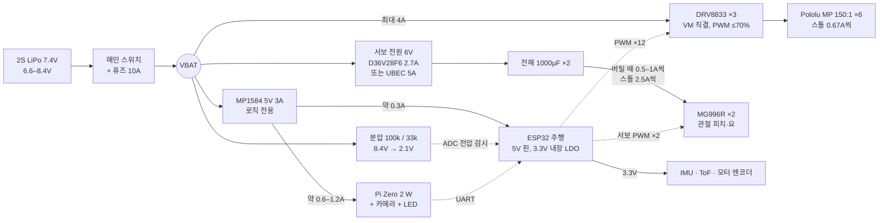
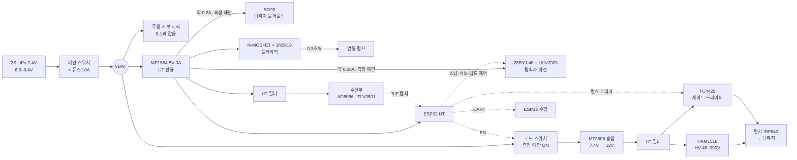

# wp6 (지도교수 안) 주행·전력부 변경 후보

- 원본: 노션 개인 기록 > 강민수 > "전체 구매 리스트"의 "wp6 (교수님 안) 주행·전력부 변경 후보" 절 (2026-11-09 작성). 2026-11-18 레포로 옮김.
- **상태**: 후보이며 팀 확정 아님. 근거는 시뮬레이션 결과([simulation/docs/05_결과_요약.md](../../simulation/docs/05_결과_요약.md))이고, 정답 배관 정보를 쓰는 oracle 제어 조건.
- 가격은 2026-11-09 디바이스마트 검색값(VAT 포함), 재고는 사이트 표시값이라 결제 전 확인 필요. 전체 부품 목록은 [팀 구매리스트](../../README.md#팀-구매리스트)가 기준.

**기준 구조 (시뮬 `wp6`)**: 2모듈 × 3륜(120°) 스프링 밀착, 6륜 모두 구동, 가운데 2축 관절(피치+요) 서보 2개, 몸통 Ø44 × 90 mm. 모델과 치수 상세는 `simulation/src/pipe_robot_sim/models/wp6/`, `simulation/docs/10_wp6_3D설계_자료.md` (2026-11-18 기준 시뮬 작업 브랜치에 있고 main 반영 전). 노션 구매 리스트의 "로봇 구성 v2"(3마디)와는 다른 안.

## 1. 주행 모터·드라이버

| 품목 | 사양 | 수량 | 가격 | 링크 | 비고 |
| --- | --- | --- | --- | --- | --- |
| 바퀴 모터 (추천) | Pololu MP 6V 150:1 + 12CPR 엔코더. 스톨 0.127 N·m(1.3 kg·cm), 150 rpm, 스톨 전류 0.67 A (Pololu 표기) | 6 | 개당 52,800원 | [#5141 측면 커넥터](https://www.devicemart.co.kr/goods/view?no=15419019) / [#5140 뒷면 커넥터](https://www.devicemart.co.kr/goods/view?no=15419048) | 재고 표시 6 / 5 → 여분까지 7개면 둘을 섞거나 재입고 확인 |
| 바퀴 모터 (토크 여유형) | 같은 MP 6V 210:1. 스톨 0.167 N·m(1.7 kg·cm), 100 rpm | 6 | 개당 52,800원 | [#5143 측면](https://www.devicemart.co.kr/goods/view?no=15855772) / [#5142 뒷면](https://www.devicemart.co.kr/goods/view?no=15855771) | 재고 표시 100 |
| 모터 드라이버 | DRV8833 2채널 (모터 2개씩) | 3 | 1,870원 / 11,880원 | [VLT-MD015](https://www.devicemart.co.kr/goods/view?no=15960240) / [Adafruit ada-3297](https://www.devicemart.co.kr/goods/view?no=1326877) | VLT 재고 표시 2. 기존 링크 KIT-5108은 실제 18,150원 |

- 기존 후보 ada-4639(N20 1:100)는 판매 페이지에 스톨 전류 200 mA로 나와 있고 스톨 토크는 미표기. Pololu LP 100:1(0.36 A, 0.74 kg·cm)보다 약한 권선이라 수직 등반에는 토크 부족으로 추정
- 필요 토크 계산(추정): 로봇 약 0.65 kg 수직 등반 + 굴림 저항 → 바퀴당 0.022 N·m, 엘보 여유 ×2, 연속 사용은 스톨의 1/3 이하 → **스톨 0.13 N·m 이상**

## 2. 관절 서보 (시뮬 결과)

| 서보 | 토크 (판매처 표기) | 가격 | 위 90° | 왼쪽 90° | 아래 90° | 링크 |
| --- | --- | --- | --- | --- | --- | --- |
| MG90S 호환 | 2.2 kg·cm (4.8 V), 14 g | 4,620원 | 0/3 | 0/1 | 0/1 | [MG90S](https://www.devicemart.co.kr/goods/view?no=1313389) |
| **MG996R 호환 (추천)** | 9.4 kg·cm (4.8 V), 55 g, 40.6×19.8×42.9 mm | 7,150원 | 서보 무게 넣으면 0/3 | 1/1 | 1/1 | [MG996R](https://www.devicemart.co.kr/goods/view?no=1313388) |
| DYNAMIXEL XL330-M288-T | 0.52 N·m (5 V), 18 g | 78,430원 (Reachy Mini용 서보암 포함 상품) | 3/3 (몸통 0.12 kg 조건) | 3/3 | 3/3 | [XL330-M288-T](https://www.devicemart.co.kr/goods/view?no=16060013) |

- 시뮬 결과는 모두 oracle 제어, 시뮬 서보는 위치 P 제어 + 토크 한계 (실물 서보 강성·응답 미반영). 1/1은 1회 실행이라 반복성 미확인
- 관절 토크 0.35 N·m 이하는 시뮬에서 위 엘보 전부 실패 → 약 0.5 N·m 이상 필요
- 위 엘보 실패 원인은 무게. 실제 장치를 넣으면 모듈당 몸통 약 0.17 kg 이상(추정)이라 XL330으로도 시뮬 통과 조건(0.12 kg)을 넘음 → 데모 배관이 수평이면 MG996R, 위 엘보가 필요하면 구조 변경이 먼저
- MG996R이 Ø44 몸통에 들어가는지 확인 필요. 재고 표시 0이라 확인 필요

## 3. 전력부 (경량안)

18650 ×2는 홀더 포함 약 110 g이고, Ø44 몸통(벽 빼면 약 Ø41) 안에 나란히 안 들어감(단면 대각 41.6 mm). → 2S 리튬폴리머(LiPo)로 바꾸고 BMS·충전 모듈은 로봇 밖으로.

| 품목 | 사양 | 수량 | 가격 | 링크 | 비고 |
| --- | --- | --- | --- | --- | --- |
| 배터리 (UT 없는 주행) | 2S 7.4 V 560 mAh 150C | 1 | 18,590원 | [DOGCOM 2S 560mAh](https://www.devicemart.co.kr/goods/view?no=16033063) | 약 20분 (평균 10 W 추정). 크기·무게 미표기 |
| 배터리 (UT 포함) | 2S 7.4 V 1000 mAh | 1 | 16,500원 | [Skyholic 7.4V 1000mAh](https://www.devicemart.co.kr/goods/view?no=1074898) | 품절 → 1000~1300 mAh 2S LiPo는 국내 RC 매장 재검색 필요 |
| 충전기 | 2S 밸런스 충전기 (IMAX B3급) | 1 | 약 2~4만원 (예상) | 디바이스마트 미취급 → 실험실 보유 확인, 없으면 국내 RC 매장 | LiPo 팩에는 보호회로가 없어 밸런스 충전 필수 |
| 서보 전원 (작은 것) | Pololu D36V28F6, 6 V 2.7 A, 17.8×20.3 mm | 1 | 40,480원 | [D36V28F6](https://www.devicemart.co.kr/goods/view?no=15855461) | 재고 표시 100 |
| 서보 전원 (5 A, 대안) | Hobbywing UBEC-5A-V2-Air, 2~8S 입력 | 1 | 19,910원 | [UBEC-5A-V2-Air](https://www.devicemart.co.kr/goods/view?no=15692295) | 페이지 품절 표시, 재입고 2주 이상 |
| 로직 5 V | MP1584 3 A 소형 | 1 (UT 포함 시 2) | 1,980원 | [VLT-VC042](https://www.devicemart.co.kr/goods/view?no=15960192) | 기존 링크(1321132)는 재고 표시 0 |
| UT 12 V | MT3608 승압, 배터리 → 12 V (HAM1518 입력) | 1 | 1,210원 | [VLT-VC018](https://www.devicemart.co.kr/goods/view?no=15959685) | UT 쓸 때만 |
| 서보 전원 버퍼 | 전해 16 V 1000 µF | 2 | 99원 | [16V 1000µF 105℃](https://www.devicemart.co.kr/goods/view?no=29524) | 재고 표시 0 → 확인 |

- 빼는 후보: 18650 ×2, 홀더, 2S BMS 5 A, 2S 충전 모듈 (전력부 약 120 g → 약 55~100 g, 추정)
- ESP32가 배터리 전압을 재서 셀당 3.3 V 이하면 정지 (LiPo 과방전 방지)
- 주행과 UT 동작(스텝모터·펌프·HV)은 펌웨어로 동시에 하지 않게 나눔 → 순간 전류가 더해지지 않음. HV 모듈은 측정할 때만 켬

## 4. 비용 변화 (기존 목록 대비, 추정)

| 구분 | 기존 | 변경 후보 |
| --- | --- | --- |
| 주행 모터 | ada-4639 ×3, 약 6.6만원 | Pololu MP ×6, 약 31.7만원 |
| 모터 드라이버 | 약 4,000원 표기 (실제 KIT-5108 ×2는 약 3.6만원) | VLT ×3 약 5,600원 또는 Adafruit ×3 약 3.6만원 |
| 관절 서보 | MG90S ×3, 약 9,000원 | MG996R ×2, 약 1.4만원 |
| 전원 | 약 4.9만원 | 배터리 약 1.7~1.9만원 + 서보 전원 2~4만원 + 강압·승압 약 5,000원 (충전기 별도) |

→ 주행 모터 때문에 약 25만원 늘어나 전체 예산 상한(약 100만원)을 넘을 수 있음

**확인 필요**

- 데모 배관에 위·아래 엘보가 들어가는지 (서보·구조 결정)
- UT 검사부를 wp6에 싣는지, 별도 마디로 끄는지
- UT 포함 데모 운용 시간 (배터리 용량 결정)
- 6륜 모두 구동할지 (일부만 구동하면 시뮬 재확인 필요)
- 재고: Pololu #5141(6)·#5140(5), MG996R, UBEC, 1000 mAh LiPo

## 5. 전력부 계통도 (UT 유무)

위 3절 경량안 기준 전원 계통도(블록 단위). 핀 번호까지 그린 상세 회로도는 부품 확정 후 작성. 모듈 배치(어느 모듈에 무엇을 넣을지)는 미정이라 생략. 실선 = 전원, 점선 = 신호. 전류는 추정값.

### 5-1. UT 없음 (주행·카메라만)

### 5-2. UT 있음 (위 구성 + UT 전원)

### 5-3. 전원 레일 요약

| 레일 | 만드는 부품 | 부하 | 전류 (추정) | UT 없음 | UT 있음 |
| --- | --- | --- | --- | --- | --- |
| VBAT 6.6~8.4 V | 2S LiPo + 스위치 + 퓨즈 10 A | 모터 드라이버, 각 강압·승압 입력 | 평균 약 1.5 A, 순간 약 10 A | O | O |
| 서보 6 V | D36V28F6 (또는 UBEC 5A) | MG996R ×2 | 0.5~2 A, 스톨 5 A | O | O |
| 로직 5 V | MP1584 #1 | Pi, 카메라, LED, 주행 ESP32 | 약 1~1.5 A | O | O |
| UT 5 V | MP1584 #2 | UT ESP32, 28BYJ-48, SG90, 펌프, 수신부 | 측정 때 약 0.5~1 A | — | O |
| UT 12 V | MT3608 (로드 스위치 뒤) | HAM1518, TC4420 | 측정 때 약 0.1~0.3 A (미확인) | — | O |

**배선 규칙**

- 서보 레일과 로직 레일은 분리: 서보가 스톨해도 Pi가 리셋되지 않게
- UT 고전압(HV·펄서) 접지는 따로 모아 배터리 근처 한 점에서만 공통 접지와 연결 (수신부 노이즈 방지)
- HV 모듈·12 V는 로드 스위치로 측정할 때만 켬. 주행과 UT 동작은 펌웨어로 동시에 하지 않음 → 순간 전류가 더해지지 않음
- 배터리 전압은 ESP32 ADC로 감시, 셀당 3.3 V(팩 6.6 V) 이하면 정지
- 추가로 필요한 부품 (위 표에 없음): 메인 스위치, 퓨즈 10 A, 분압 저항 100k·33k, 로드 스위치(P-MOSFET), 펌프용 N-MOSFET, LC 필터용 인덕터

## 6. 이후 팀 자료와 다른 점 (2026-11-18 확인)

이 후보를 쓴 뒤 올라온 팀 자료와 차이가 있어 함께 적어 둠. 어느 쪽도 확정은 아님.

- 김민아 원통형 몸체 v1([docs/김민아/26.11.18.cylindrical-body_v1](../김민아/26.11.18.cylindrical-body_v1/mechanical/cylindrical-body/README.md)): 앞 Ø42×75 mm(수동 옴니휠 3), 뒤 Ø42×105 mm(구동 3, ESP32·드라이버·배터리). 이 문서는 Ø44×90 mm 두 모듈·6륜 구동 기준
- 주보현 스프링 후보 MISUMI UY6-25([docs/주보현/2026-11-09-guide-and-spring-research.md](../주보현/2026-11-09-guide-and-spring-research.md)): k 0.098 N/mm, 예압 약 0.39 N. 시뮬 wp6는 1000 N/m, 예압 8 N이라 약 20배 차이
- `drive/ESP_Code`는 엔코더 4채널(PCNT ×4)까지 연결됨. 6륜 모두 엔코더 피드백을 쓰려면 확장 필요
