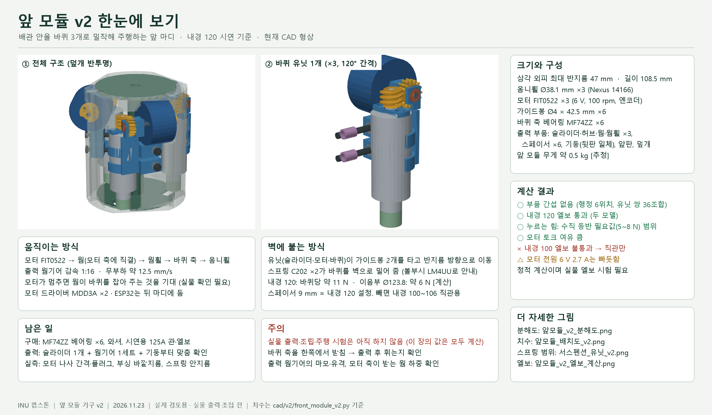
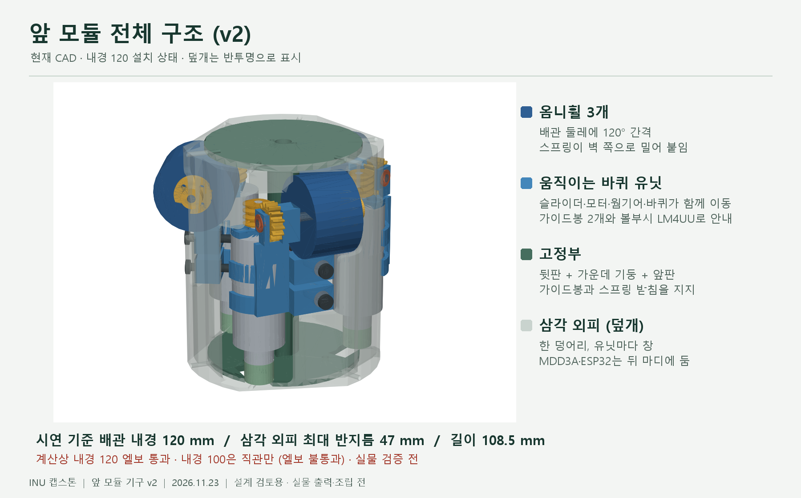
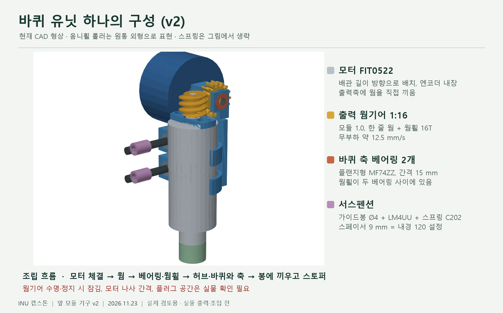
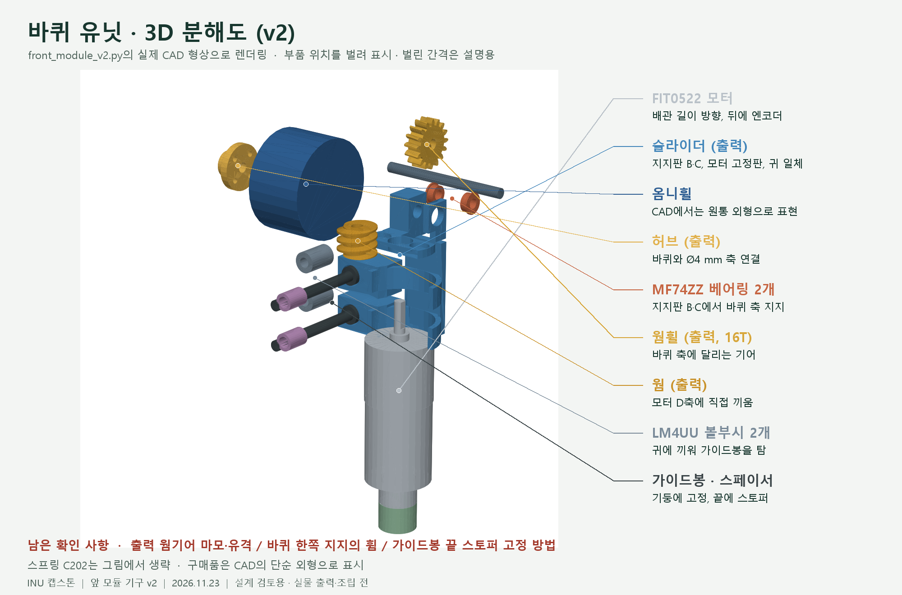
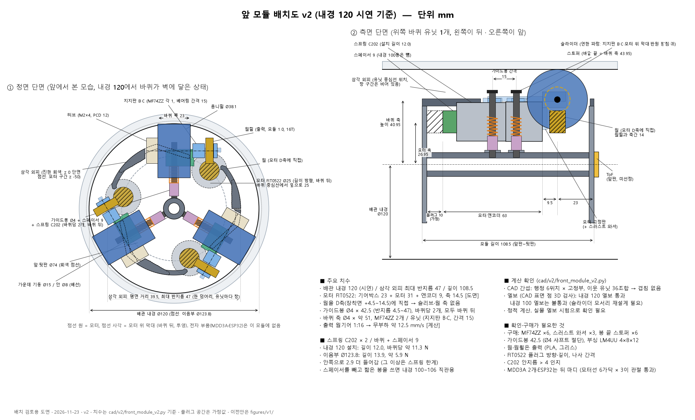
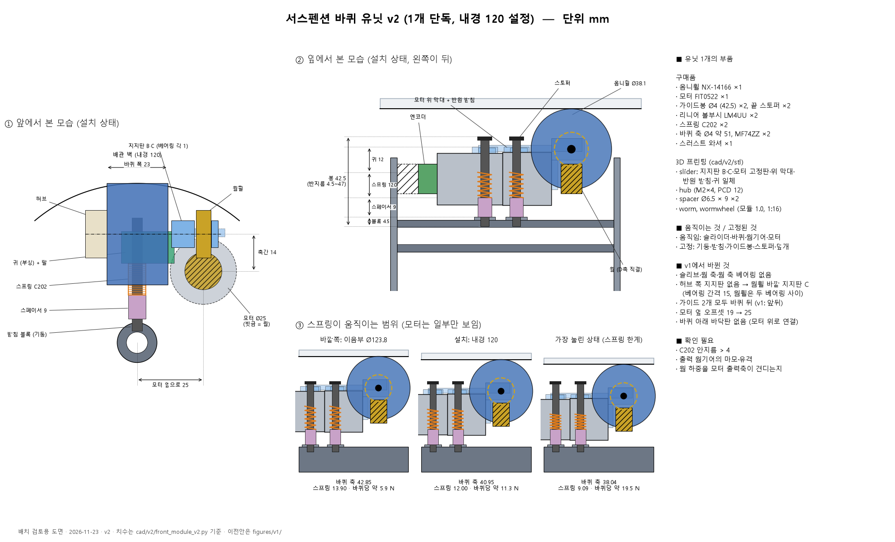
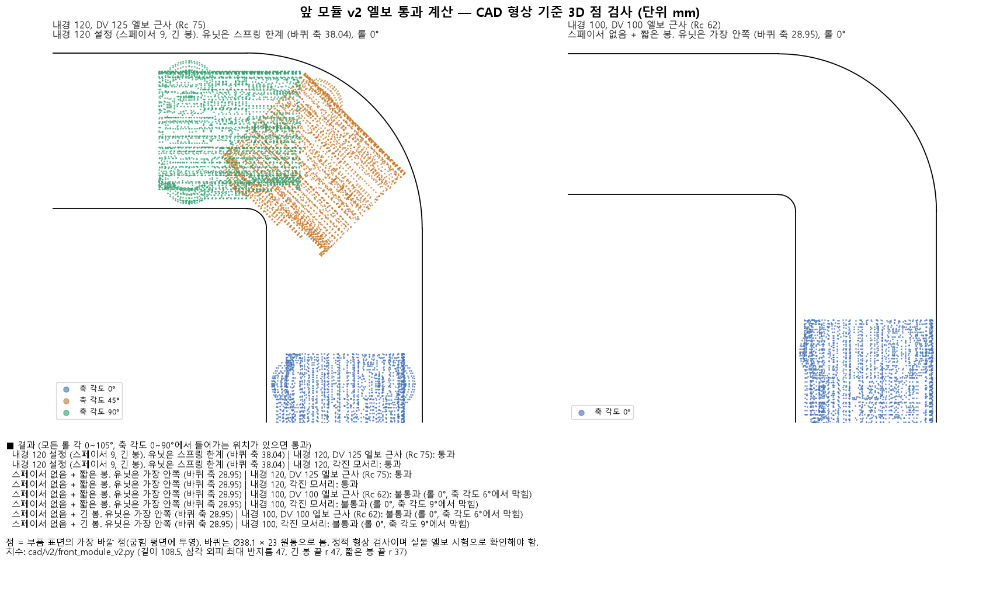
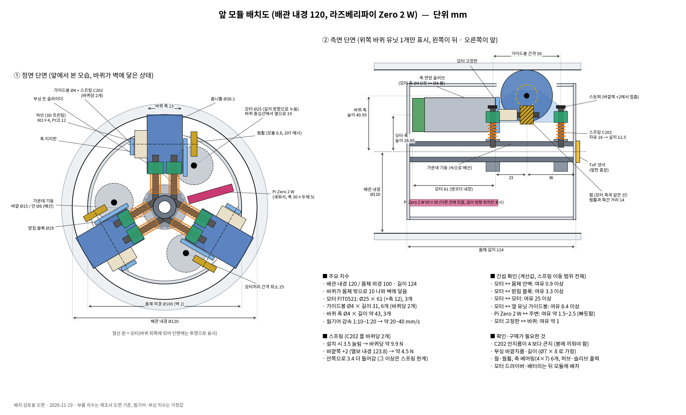
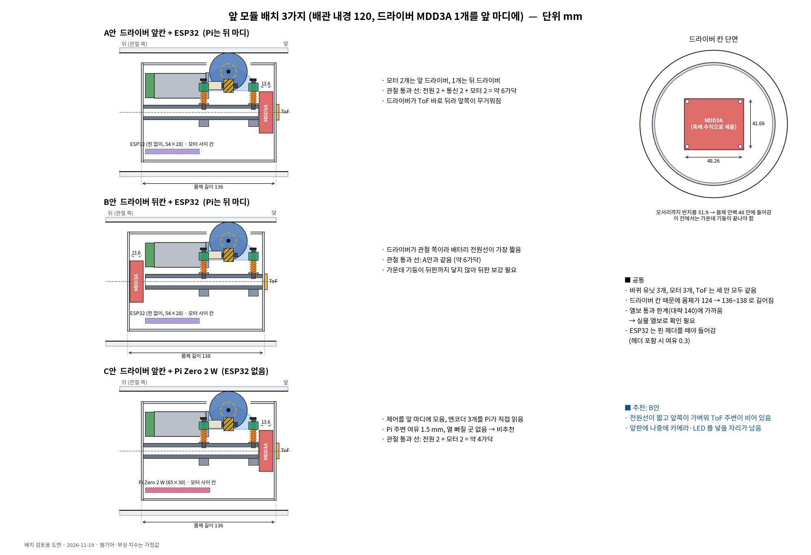
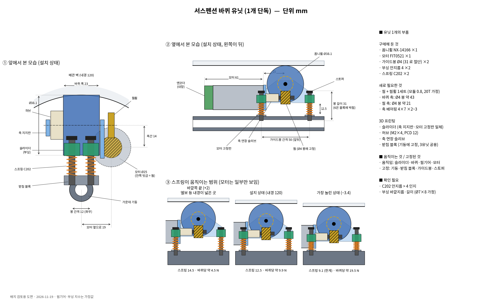

# 구동·전원 부품 치수 조사 (앞 모듈 설계용)

- 작성: 2026-11-19. 갱신: 2026-11-23 (현재안 v2 기준으로 정리, v1 내용은 맨 아래 부록으로 옮김). UT 회로 부품은 이번 조사에서 뺌.
- 값 옆 표시: **[도면]** 제조사 도면·데이터시트, **[판매]** 판매처 글, **[계산]** 위 값으로 계산, **[미확인]** 찾지 못함.
- 바퀴 모듈용 금속 부품 (팀 구매리스트 기준, 실물 실측 전):
  - 가이드봉·바퀴 축: 샤프트 Ø4 × 100 mm, 12개
  - 부싱: 리니어 볼부시 LM4UU, 안지름 4 × 바깥지름 8 × 길이 12 [판매], 6개
  - 스프링: C202, 20개
- 현재 설계와 부품 현황:
  - CAD: [cad/v2/README.md](cad/v2/README.md)
  - 구매 현황: [실현성·부품 점검](2026-11-23-앞모듈_v2_실현성_부품점검.md)

## 1. 시험 배관 — 내경 120 (팀 확정, 2026-11-19)

> 현재 방향 (2026-11-20~23 대화): 시연은 내경 120에서 하되, 구조는 내경 100~120 호환과 엘보 통과를 목표로 한다. 팀 회의 확정 여부는 기록되지 않았다.
>
> 팀 구매리스트(2026-11-17 수정본)에 있는 배관은 100A VG1 1 m × 2뿐이다. 내경 120 시연용 관과 엘보는 아직 사지 않았다.

**설계 기준 내경은 120 mm (반지름 60).** 국내 KS PVC 관 중에서는 125A(외경 140)의 두꺼운 등급(SDR13.6, 내경 119.4)이 가장 가까움. 참고용 규격표는 아래와 같음.

| 규격 | 외경 | 두께 | 내경 | 근거 |
| --- | --- | --- | --- | --- |
| VG1 125A (KS M 3404:2009) | 140 | 7.0 | 125 | [도면] |
| VG2 125A (2009) | 140 | 4.1 | 131 | [도면] |
| 125 SDR17 (2021 개정, 비압력용) | 140 | 8.2 | 123.6 | [도면], 내경은 [계산] |
| 125 SDR13.6 | 140 | 10.3 | 119.4 | [도면], 내경은 [계산] |
| 125 SDR33 | 140 | 4.2 | 131.6 | [도면], 내경은 [계산] |

- 같은 125A라도 등급에 따라 내경이 119.4~131.6으로 다름.
  - 건자재114 125A는 4 m당 무게(20.64 kg)로 보면 SDR17(내경 약 123.6)로 추정 [계산]. 내경 120 관과는 다른 제품일 수 있음.
  - 실제로 쓰는 관 내경은 직접 재서 확인할 것.
- 구매처
  - 건자재114 125A 4 m: 59,500원 [판매]
  - 1canmall VN 125A 4 m: 48,300원 [판매]
  - 투명 PVC 125A(내경 128): 3 m에 17~23만원대, 단종된 곳도 있음 [판매]
- 출처: KS M 3404 표(dycmd.com 게시 PDF), 대성산업 pvc.or.kr product01, gunjajae114.com, m.1canmall.com, okpvc.com

### 엘보·T (DV, KS M 3410, 대성산업 pvc.or.kr product02 [도면])

| 125 부속 | Z | L | 소켓 깊이 | 몸통 내경 | 몸통 외경 |
| --- | --- | --- | --- | --- | --- |
| DV 90° 엘보 (실제 91°10′) | 75 ±2 | 140 | 65 | 123.8 | 151 |

- 125 DV 엘보·T의 몸통 내경 123.8은 내경 120 관보다 큼. 이음부에서 약 2 mm 단차가 생김.
| DV T (Z1/Z2/Z3) | 75/76/75 | 140/141/140 | — | 123.8로 추정 [미확인] | — |

- Z는 굽힘 반경이 아니라 중심선 교차점에서 소켓 바닥까지의 거리. 안쪽 모서리가 거의 각진 짧은 엘보임.
- 100A에서 쓰던 "R61"(Z 62)에 해당하는 값은 125에서 **Z 75**.
- 큰 곡률 엘보(DV-LL)는 75~100만 있고 125는 찾지 못함 [미확인].

## 2. 구동부

### 구매 모터 — DFRobot FIT0522 (6 V, 100 rpm, 1:75) — 재고 사유로 FIT0521에서 변경

| 항목 | 값 |
| --- | --- |
| 지름 | 기어박스 Ø25, 모터 Ø24.4, 엔코더 뒤 돌출부 Ø14 [도면] |
| 길이 (장착면 기준) | 기어박스 23, 모터 끝까지 54 (= 제조사 표기 "54"), 엔코더 끝까지 63 (23 + 40 REF) [도면]. 플러그·전선 제외 |
| 출력축 | Ø4 D컷(평면 3.5), D 구간 10, 장착면에서 축 끝까지 14.5. 앞 돌출부 Ø7 × 2.5 [도면] |
| 기어박스 면 고정 구멍 | 사진에 구멍 2개, 치수 없음 [미확인]. 같은 25 mm 계열 JGA25-370 판매 사양은 M3 × 2, 간격 17, 깊이 4.5 [판매, 다른 제품] |
| 성능 | 무부하 100 rpm·0.13 A, 최대효율점 1.0 kg·cm·80 rpm·0.5 A, 최대출력점 3.0 kg·cm·55 rpm·1.0 A, 스톨 6.5 kg·cm·3.0 A [도면 PDF 사양] |
| 엔코더 | 홀, 3.3/5 V, 모터축 11 CPR, 출력축 823.1 PPR (11 × 74.83) [도면 PDF 사양]. 계수 정의는 실측 확인 |
| 커넥터 핀 | JST 6핀: 1 모터 GND, 2 엔코더 GND, 3 A, 4 B, 5 엔코더 VCC, 6 모터 VCC [위키] |
| 무게 | 96 g |

- FIT0521보다 기어박스가 2 mm, 출력축이 2.5 mm 길다. 현재 CAD(v2)는 이 도면 치수로 만들었다. v1 CAD에 준 영향은 [cad/v1/README.md](cad/v1/README.md) 참고.
- 출처: [FIT0522 측면도·사양 PDF](https://www.micro-semiconductor.jp/datasheet/04-FIT0522.pdf), [wiki.dfrobot.com/fit0522](https://wiki.dfrobot.com/fit0522/), [JGA25-370 판매 사양](https://rcdrone.top/products/jga25-370-dc-gear-motor)

### 교체 전 모터 — DFRobot FIT0521 (6 V, 210 rpm, 1:34)

| 항목 | 값 |
| --- | --- |
| 지름 | 기어박스 Ø25, 모터·엔코더 Ø24.4 [도면] |
| 길이 | 본체(기어+모터) 52 [판매]; 엔코더·커넥터 포함 약 61, 출력축까지 약 73 [계산] |
| 출력축 | Ø4 D컷(평면 3.5), D 구간 8, 면에서 총 12 (Ø7×2.5 부싱 포함). 축은 몸통 중심에 있음 [도면] |
| 기어박스 면 고정 구멍 | 사진에 탭 구멍이 보이지만 치수 없음 [미확인]. 모터 각인 "DF25-370" |
| 성능 | 무부하 210 rpm·0.13 A, 최대효율점 2.0 kg·cm·170 rpm·0.6 A, 최대출력점 5.2 kg·cm·110 rpm·1.1 A, 스톨 10 kg·cm·3.2 A [판매] |
| 엔코더 | 홀, 3.3/5 V, 모터축 11 CPR. 출력축 기준 341.2(위키)와 374.22(상품 페이지)가 서로 다름 → 실측 필요 |
| 커넥터 핀 | JST 6핀: 1 모터−, 2 엔코더 GND, 3 A, 4 B, 5 엔코더 VCC, 6 모터+ [도면] |
| 무게 / 가격 | 96 g / 32,200원(VAT 별도) |

- 출처: dfrobot.com/product-1617.html, wiki.dfrobot.com/fit0521, FIT0520 치수도·핀맵 이미지

### 옴니휠 — Nexus NX-14166 (38 mm 알루미늄 2열)

| 항목 | 값 |
| --- | --- |
| 외경 / 폭 | Ø38.10 / 23.00 [도면] |
| 중심 구멍 | Ø4.00 원형 (D컷·키홈 없음) [도면] |
| 구동 구멍 | 4 × Ø2.10, PCD 12.00 (M2) [도면] |
| 롤러 | 8개 (4개 × 2열), PU 코팅 [판매] |
| 허용 하중 / 무게 | 2 kg / 28 g [판매] |

- 모터 축(Ø4 D컷)에 끼워지기는 하지만, 그대로는 회전이 전달되지 않음. D컷 구멍과 M2 × 4 @PCD 12 플랜지가 있는 허브가 필요.
- 출처: nexusrobot.com 14166 도면 PDF, STEP 파일(14166.zip)

### 기타

| 부품 | 핵심 치수·사양 | 메모 |
| --- | --- | --- |
| 리니어 볼부시 LM4UU | 안지름 4 × 바깥지름 8 × 길이 12 [판매]. 실물 실측 전 | 6개 구매. 가이드봉을 타는 부싱. v2 CAD 귀 구멍 Ø8.1 |
| 샤프트 Ø4 × 100 | [판매] | 12개 구매. 잘라서 가이드봉(42.5)과 바퀴 축(약 51)으로 씀 |
| MF74ZZ 플랜지 베어링 | 4 × 7 × 2.5, 플랜지 Ø8.2 × 0.6 [도면, NSK] | 미구매. 바퀴 축 베어링, 유닛당 2개 |
| N20 고무바퀴 FIT0494 | Ø43 × 9, 14 g [판매], 구멍 [미확인] (N20용 3 mm D로 추정) | FIT0522(Ø4 D축)에는 맞지 않음. v2에서 쓰지 않음 |
| 압축 스프링 C202 (아큐레이트, 디바이스마트 15336219) | 외경 6.5, 자유 길이 16, 11.69 mm일 때 6.08 N, 9.09 mm일 때 9.76 N(최대) [판매] → **약 1.41 N/mm, 최대 압축 6.9 mm** [계산]. 선경·밀착 길이 [미확인] | 개당 1,800원, 반품 불가 |
| 모터 드라이버 MDD3A | 48.26 × 41.66, 고정 구멍 4 × Ø3 (간격 43.18 × 36.58) [도면]. 높이 약 13.6, 무게 약 14 g [판매] | 채널당 3 A 연속 / 5 A 순간(5초 미만). 4~16 V. 모터 스톨 3.2 A는 순간 범위 안에 듦 |

## 3. 전원·제어

| 부품 | 크기 (mm) | 무게 | 핵심 사양 | 메모 |
| --- | --- | --- | --- | --- |
| LiPo 2S 560 mAh 150C (DOGCOM) | 63 × 18 × 14 [판매] | 33 g | XT30 방전 플러그, JST-XH 3핀 밸런스, 충전 1C | |
| ESP32 DevKitC V4 (WROOM-32D, CH9102X) | 기판 48.26 × 27.94, 안테나 포함 약 54.3 [도면] | [미확인] | 핀 간격 2.54, 두 열 중심 간격 25.40, 2 × 19핀 | 판매품은 호환 보드라 실측 권장. 핀 포함 높이 [미확인] |
| Pololu D36V28F6 (6 V 강압) | 17.8 × 20.3 × 8.8 [도면] | 3.3 g | 입력 6.3~50 V, 6 V 출력 약 2~4 A (발열로 제한) | M2 구멍 2개 대각(간격 13.5 × 16.0). **2S 배터리가 거의 다 되면(약 6.4 V) 출력 6 V가 떨어질 수 있음** |
| MP1584EN 강압 (VLT-VC042) | 22 × 17 × 4 [판매] | [미확인] | 4.5~28 V 입력 → 0.8~20 V 출력, 최대 3 A | 고정 구멍 없음 (양면테이프·브래킷) |
| MT3608 승압 (VLT-VC018) | 일반품 약 37 × 17 × 7 [판매, 다른 판매처] | [미확인] | 2~24 V 입력 → 5~28 V 출력, "2 A" (실사용 1 A 권장) | 고정 구멍 없음 |
| LM2587 승압 (VLT-VC028, HW-163) | [미확인] | [미확인] | 3.5~30 V 입력 → 4~30 V 출력, 연속 2~2.5 A | 모서리에 구멍 4개 (치수 미확인) |
| LM2587 승압 (JK전자 38304) | 49 × 23 × 11 (가변저항 제외) [판매] | [미확인] | 4~34 V 입력 → 4~60 V 출력, 25 W | "5 A"는 스위치 전류 한계라 실제 출력 전류 아님 |

- 출처: devicemart.co.kr `goods/view_contents?no=<상품번호>`(상세 설명 텍스트), pololu.com/product/3783, Espressif DevKitC V4 치수 PDF, MDD3A 데이터시트

## 4. 내경 120 배관에서 앞 모듈 배치 확인 [계산]

2026-11-19에 배치 방식을 고를 때 한 계산이다. 현재안의 값은 5절에 있다.

조건: 내경 120 (반지름 60), 바퀴 Ø38.1, 모터 Ø25.

| 배치 | 결과 |
| --- | --- |
| 모터를 바퀴와 같은 축으로 가로 배치 (바퀴가 길이 방향으로 구름) | 바퀴가 벽에 닿을 때 바퀴 축은 중심에서 41.0 mm. 이 높이에서 Ø25 모터가 벽에 닿지 않고 옆으로 뻗을 수 있는 길이는 **24.1 mm**. 필요한 길이는 약 72 mm → **들어가지 않음** |
| 모터를 길이 방향으로 눕히고 웜·베벨 기어로 90° 꺾기 | 모터 바깥쪽이 중심에서 53.5 mm, 벽은 60 mm → **들어감**. 웜기어는 정지 시 잠김(수직관에서 미끄러지지 않음), 감속도 같이 됨 |
| 모터 축을 배관 축과 나란하게 두고 바퀴를 둘레 방향으로 굴림 (롤 회전용) | 모터를 바퀴 축과 같은 축으로 둬도 들어감. 다만 이 배치로는 전진하지 못함 |
| 직선 가이드 + 스프링을 반지름 방향으로 쌓기 (베이스 3 + C202 최대 압축 9.1 + 브래킷 5 + 모터 반지름 + 바퀴 반지름) | 중심부에 남는 반지름 11.4 mm. 3방향을 한 단면에 두면 빠듯함 |

- 수직 등반에 필요한 값 (로봇 0.8~1.2 kg, 마찰계수 0.5 가정)

  | 구동 바퀴 수 | 바퀴당 토크 | 바퀴당 밀착력 |
  | --- | --- | --- |
  | 3개 | 0.5~0.8 kg·cm | 5~8 N |
  | 6개 | 0.25~0.4 kg·cm | 2.6~3.9 N |

  - FIT0521 최대출력점(5.2 kg·cm)에 비해 토크 여유는 큼. 구매한 FIT0522 최대출력점(3.0 kg·cm)도 추가 감속 없이 필요값보다 큼 [계산].
  - C202 한 개는 최대 9.8 N이라 밀착력은 맞음. 하지만 움직일 수 있는 거리가 6.9 mm라, 이음부 단차(약 2 mm)와 엘보 통과까지 감당하기에는 빠듯함 → 스프링 직렬 배치나 지렛대 비율이 있는 팔 구조 검토.
- 교체 전 FIT0521(210 rpm)의 직결 무부하 속도는 약 420 mm/s였고 추가 감속비 후보는 1:5~1:10이었다.
- 구매한 FIT0522는 내장 감속비 약 1:75, 6 V 무부하 출력축 100 rpm이다. Ø38.1 mm 바퀴와 추가 웜 감속 1:20을 가정하면 바퀴는 5 rpm, 이론 속도는 π × 38.1 × 5 / 60 ≈ 9.97 mm/s (0.60 m/min)다. 같은 조건에서 1:5는 39.9 mm/s, 1:10은 19.9 mm/s다. 부하와 미끄럼을 제외한 계산이며 목표 속도와 필요한 토크를 정한 후 감속비를 선택한다. 1:5~1:10을 웜으로 만들려면 다줄 웜이 필요하고, 그러면 위 배치 표에서 웜을 고른 근거인 정지 시 잠김이 약해지거나 없어질 수 있다 [추정, 기어 선정 시 리드각으로 확인]. [DFRobot FIT0522 사양](https://wiki.dfrobot.com/fit0522/)

## 5. 앞 모듈 현재안 v2 (내경 120 시연 기준)

2026-11-21~23 대화에서 정한 방향이다. 팀 회의 확정 여부는 여기에 기록하지 않았다.

- 내경 120 시연을 기준으로 하고, C202 스프링에 스페이서 9 mm를 끼워 쓴다. 스페이서를 빼고 가이드봉을 짧은 것으로 바꾸면 내경 100~106 설정이 된다. 다만 내경 100은 계산상 직관만 가능하고 엘보는 통과하지 못한다 (아래).
- 설계 근거: [v2 호환 검토](2026-11-20-앞모듈_v2_호환_검토.md). CAD: [cad/v2/README.md](cad/v2/README.md). 부품·구매 현황: [실현성·부품 점검](2026-11-23-앞모듈_v2_실현성_부품점검.md).
- 실물 출력·조립은 아직 하지 않았다.

| 항목 | 값 |
| --- | --- |
| 크기 | 삼각 외피 (2026-11-24부터. 평면 거리 39.5, 꼭짓점 반지름 47, 한 덩어리, 평면마다 창), 길이 108.5, 앞뒤 판 Ø74 |
| 바퀴 유닛 | 3개, 120° 간격. 모터는 길이 방향으로 바퀴 뒤, 바퀴 중심선에서 옆으로 25 |
| 구동 | FIT0522 D축에 출력 웜(모듈 1.0, 한 줄)을 직접 끼움 → 출력 웜휠 16T. 감속 1:16, 축간 14 |
| 바퀴 축 지지 | 지지판 B(바퀴 쪽)·C(웜휠 바깥)에 MF74ZZ 하나씩, 베어링 간격 15 |
| 서스펜션 | 유닛마다 가이드봉 Ø4 2개(바퀴 뒤) + LM4UU + C202. 기구 행정 15 (바퀴 축 28.95~43.95) |
| 전자 부품 | MDD3A 2개·ESP32는 뒤 마디. 모터선 6가닥 × 3이 관절을 지남 |
| 속도 [계산] | 무부하 약 12.5 mm/s (FIT0522 100 rpm ÷ 16, 바퀴 Ø38.1) |

3D 설명 페이지: [figures/앞모듈_v2_3D_설명.html](figures/앞모듈_v2_3D_설명.html). 내려받아 브라우저로 열면 돌려 보고 단계별로 분해해 볼 수 있다 (만드는 스크립트 `figures/앞모듈_v2_3D_build.py`).

한 장 요약:

3D 설명 그림 (스크립트 `figures/앞모듈_v2_설명그림_draw.py`):

치수 도면:

- PDF: [figures/2026-11-21-앞모듈_배치도_v2.pdf](figures/2026-11-21-앞모듈_배치도_v2.pdf)
- 그린 스크립트: `figures/앞모듈_v2_배치도_draw.py` (인자: 배치도 png, 배치도 pdf, 유닛 png). 치수와 덮개 모양은 `cad/v2/front_module_v2.py`에서 읽는다.
- 스프링 [계산]: C202 상수 약 1.41 N/mm, 바퀴당 2개 기준이다.
  - 내경 120 설치: 스프링 길이 12.0, 바퀴당 약 11.3 N
  - 이음부 Ø123.8: 길이 13.9, 약 5.9 N
  - 스프링 한계(허용 압축 높이 9.09)는 바퀴 축 38.04에서 걸린다. 내경 120 접촉 위치에서 안쪽으로 2.9 mm 더 들어갈 수 있다.
  - 위 값은 바퀴가 폭 가운데에서 벽에 닿는다고 본 것이다. 바퀴 폭이 23이라 둥근 관에서는 가장자리가 먼저 닿는다. 폭 전체가 원통이라면 내경 120에서 바퀴 축이 최대 1.1 mm 더 안쪽(39.84)에 놓이고, 그때 힘은 바퀴당 약 14.4 N이다. 실제 옴니휠은 롤러가 둥글어 그 사이 값이 된다.
- 엘보 [계산, CAD 표면 점 3D 검사. `cad/v2/elbow_results.txt`]:
  - 내경 120 설정: 내경 120 엘보 두 모델(DV 125 근사, 각진 모서리) 통과
  - 내경 100 엘보: 스페이서를 빼고 짧은 봉을 써도 두 모델 모두 불통과 (바퀴를 원통으로 볼 때). 삼각 외피(2026-11-24)에서는 바퀴 가장자리를 둥글게 봐도 두 모델 모두 불통과다. 이전 원통 덮개에서는 그 경우 DV 100 근사 모델만 통과했다. 내경 100 직관에는 들어간다.
  - 정적 형상 검사다. 실물 엘보 시험으로 확인해야 한다.

## 부록. 이전안 v1 기록 (2026-11-19)

v1은 내경 120 전용 1차안이다. 그림과 스크립트는 `figures/v1/`, CAD는 `cad/v1/`에 보관한다. 그만둔 이유는 [v2 호환 검토](2026-11-20-앞모듈_v2_호환_검토.md) 2절에 있다.

### A1. 앞 모듈 배치도 (내경 120, Pi Zero 2 W)

- PDF: [figures/v1/2026-11-19-앞모듈_배치도.pdf](figures/v1/2026-11-19-앞모듈_배치도.pdf), 그린 스크립트: `figures/v1/앞모듈_배치도_draw.py` (실행 시 출력 파일 경로를 인자로 줌. 글꼴 경로가 Linux 기준)
- 웜기어(모듈 0.8, 20T, 축간 거리 14)와 부싱(Ø7 × 8) 치수는 가정값. 부품이 정해지면 스크립트 숫자를 바꿔 다시 그릴 것.

### A2. 드라이버를 앞 마디에 둘 때의 배치 3가지

- MDD3A 1개를 축에 수직으로 세워 별도 칸에 넣음. 몸체 길이 124 → 136~138.
- 추천은 B안(드라이버 뒤칸 + ESP32, Pi는 뒤 마디).

### A3. 서스펜션 바퀴 유닛 (1개 단독)

- 그린 스크립트: `figures/v1/앞모듈_3안_서스펜션_draw.py` (인자: 3안 그림 경로, 유닛 그림 경로)

### A4. 앞 모듈 CAD (STL·STEP)

- [cad/v1/README.md](cad/v1/README.md): 출력 부품 7종, 조립 순서, 가정값.
- CAD 간섭 검사에서 웜과 바퀴가 겹치는 것을 찾아, 모터·웜 위치를 바퀴 중심선에서 옆으로 17 → 19 로 옮김. A1~A3 그림도 19 기준으로 다시 그림.
