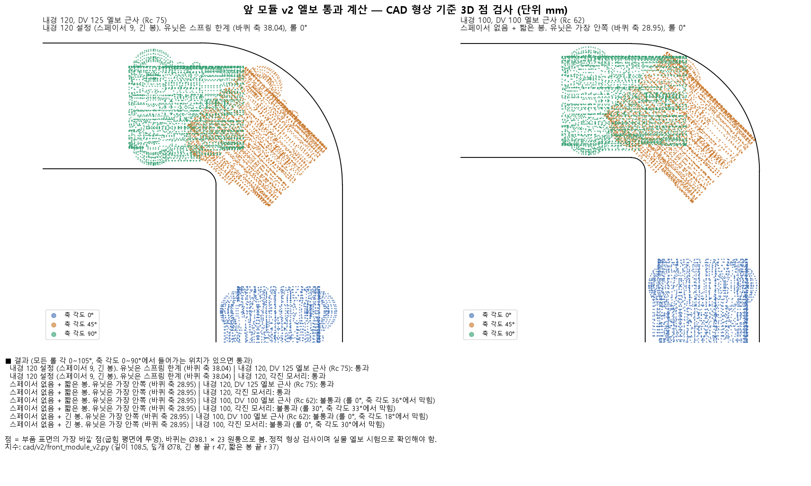

# 앞 모듈 v2 설계 근거 — 내경 100~120 호환 검토

- 작성: 2026-11-20. **2026-11-23에 현재 CAD(v2) 기준으로 다시 썼다.** 처음 검토안과 달라진 점은 7절에 있다.
- 현재 설계: [cad/v2/README.md](cad/v2/README.md). 부품·구매 현황: [실현성·부품 점검](2026-11-23-앞모듈_v2_실현성_부품점검.md). 배치도: [부품 치수 조사 5절](2026-11-19-부품_치수_조사.md#5-앞-모듈-현재안-v2-내경-120-시연-기준).
- 값 표시: **[도면]** 제조사 도면, **[계산]** 스크립트 계산, **[가정]** 정하지 않은 값.
- 실물 출력·조립·엘보 시험은 아직 하지 않았다. 아래 결과는 모두 계산이다.

## 1. 요구 조건 (2026-11-20~23 대화에서 확인)

- 시연은 내경 120 배관에서 한다. 구조는 내경 100~120에 맞출 수 있게 한다.
- 엘보를 통과해야 한다.
- 서스펜션은 직선 가이드(가이드봉 + 부싱 + 스프링)를 유지한다.
- 우선 내경 120 기준으로 진행한다 (2026-11-21). 스프링은 구매한 C202에 스페이서 9 mm를 끼워 쓴다.

팀 회의에서 확정한 결정인지는 이 문서에 기록하지 않았다.

## 2. v1 CAD를 그만둔 이유 [계산]

| 항목 | v1 (내경 120 전용) | 100~120 호환에 필요한 값 |
| --- | --- | --- |
| 바퀴 축 높이 | 40.95 (+2 / −3.4) | 30.95 (내경 100) ~ 42.85 (내경 120 이음부 Ø123.8) |
| 가이드 행정 | 5.4 | 11.9 이상 |
| 몸체 | Ø100 원통 외피, 길이 142 | 내경 100 관에 들어가는 고정부 |
| 엘보 | 내경 120 엘보도 불통과 | 통과 |

v1의 엘보 불통과는 외피 Ø100 × 길이 142만 강체로 본 계산이다. 각진 90° 모서리 공식 L = 2(√2·D − w)로 내경 120, 몸체 Ø100의 한계는 139.4 mm이고, 길이 142는 이보다 길다.

## 3. 검토 방법

- **간섭 검사** ([cad/v2/front_module_v2.py](cad/v2/front_module_v2.py), 결과 `cad/v2/check_results.txt`)
  - 실제 CAD 솔리드끼리 겹치는 부피를 계산한다. 0.01 mm³ 초과를 보고한다.
  - 바퀴 축 변위 6개 위치(−12, −10, −2.91, 0, +1.9, +3)에서 유닛과 고정부를 비교한다.
  - 이웃한 두 유닛은 위치 6 × 6 = 36조합을 비교한다.
- **엘보 통과 계산** ([figures/앞모듈_v2_검토.py](figures/앞모듈_v2_검토.py), 결과 `cad/v2/elbow_results.txt`)
  - CAD 부품(고정부 + 유닛 3개)의 표면에서 가장 바깥 점을 뽑는다 (z 2 mm × 둘레 5° 칸마다 하나, 약 3,900점).
  - 점이 배관 안에 있는지 3D로 판정한다. 엘보는 중심선이 한 평면에 있는 90° 굽힘이다.
  - 로봇 축은 굽힘 평면 안에 둔다. 축 각도 0~90°(3° 간격)마다 들어가는 위치를 1 mm 격자로 찾는다.
  - 로봇이 자기 축 둘레로 돈 각(롤) 0~105°(15° 간격) 모두에서 성립해야 통과로 본다.
  - 유닛 3개는 그 설정에서 가장 안쪽 위치(스프링 한계)에 둔다.
  - 바퀴는 Ø38.1 × 23 원통으로 본다. 실제 옴니휠은 가장자리가 둥글어 이보다 작다.
- **배관 모델 네 가지**
  - 내경 120 + DV 125 엘보: 중심선 반지름 75로 근사 (125 DV 엘보 Z 75 [도면])
  - 내경 120 각진 모서리 (두 직관의 교차)
  - 내경 100 + DV 100 엘보: 중심선 반지름 62로 근사 (100A 엘보 Z 62)
  - 내경 100 각진 모서리
- **한계**
  - 정적 형상 검사다. 각도 사이의 연속 경로, 바퀴 힘·마찰은 넣지 않았다.
  - 로봇 축이 굽힘 평면을 벗어나는 자세, 관절과 뒤 모듈, 엘보 소켓 단차는 넣지 않았다.
  - 스프링, 나사, 배선은 형상에 없다.
  - 실물 엘보 시험으로 확인해야 한다.

## 4. 현재 배치 (CAD v2)

| 항목 | 값 |
| --- | --- |
| 바퀴 | Nexus 14166 Ø38.1 × 23 [도면], 3개, 120° 간격 |
| 바퀴 축 높이 범위 | 28.95 ~ 43.95 (기구 행정 15). 내경 120 접촉 40.95 |
| 모터 | FIT0522 [도면]. 길이 방향으로 바퀴 뒤, 바퀴 중심선에서 옆으로 25, 바퀴 축 아래 14 |
| 웜기어 | 출력 부품. 모듈 1.0, 한 줄 웜 + 16T, 감속 1:16, 축간 14. 웜을 모터 D축에 직접 끼움 |
| 바퀴 축 지지 | 지지판 B(바퀴 쪽)·C(웜휠 바깥)에 MF74ZZ 하나씩, 간격 15. 허브 쪽 지지판은 없음 |
| 가이드 | 유닛마다 봉 Ø4 2개, 둘 다 바퀴 뒤 (z −26, −41). 봉은 기둥에 고정, LM4UU(4×8×12)를 넣은 귀가 이동 |
| 가이드봉 | 반지름 4.5 ~ 47 (길이 42.5). 내경 100 설정용 짧은 봉은 끝 37 (길이 32.5) |
| 스프링 | C202 2개 / 바퀴 + 스페이서 9 (내경 120 설정). 스페이서를 빼면 내경 100~106 설정 |
| 몸체 | 뒷판·앞판 Ø74 + 가운데 기둥 Ø15 + 덮개 Ø78 (한 덩어리, 두께 2~4, 유닛마다 창) |
| 길이 | 108.5 = 앞판 3 + 틈 0.95 + 바퀴 반지름 19.05 + 장착면까지 9.5 + 모터·엔코더 63 + 플러그 10 [가정] + 뒷판 3 |
| 전자 부품 | MDD3A 2개·ESP32는 뒤 마디 |

## 5. 결과 [계산]

### 간섭

행정 6개 위치 × 고정부, 이웃 유닛 36조합, 유닛 내부 모두 겹침 없음.

### 엘보 통과

| 설정 | 내경 120, DV 125 근사 | 내경 120, 각진 모서리 | 내경 100, DV 100 근사 | 내경 100, 각진 모서리 |
| --- | --- | --- | --- | --- |
| 내경 120 설정 (스페이서 9, 긴 봉), 유닛은 스프링 한계 (바퀴 축 38.04) | 통과 | 통과 | — | — |
| 스페이서 없음 + 짧은 봉, 유닛은 가장 안쪽 (28.95) | 통과 | 통과 | **불통과** (롤 0°, 축 각도 36°) | **불통과** (롤 30°, 축 각도 33°) |
| 스페이서 없음 + 긴 봉, 유닛은 가장 안쪽 (28.95) | — | — | **불통과** | **불통과** |

- **내경 120 시연 조건은 성립한다.**
- **내경 100 엘보는 지금 CAD로는 통과하지 못한다.**
  - 2026-11-20 검토에서는 통과로 나왔다. 그때는 2D 단순 형상 계산이었고, 유닛의 가장 바깥을 모터 표면으로 잡았다.
  - 실제 CAD에서는 슬라이더의 모터 위 막대 모서리가 모터보다 약 3.6 mm 더 바깥이다 (유닛이 가장 안쪽일 때 반지름 45.2 대 41.6). 이 막대가 z −44 ~ −9 구간에 길게 있다.
  - 지지판 C와 웜휠 모서리도 반지름 46~47까지 나간다.
  - 바퀴를 납작한 원통으로 본 것도 영향을 준다. 진단으로 바퀴 가장자리를 반지름 5로 둥글려 다시 계산하면, DV 100 근사 모델은 통과하고 각진 모서리는 불통과다 (`python 앞모듈_v2_검토.py --round-wheel`).
  - 즉 내경 100 엘보는 여유가 거의 없는 경계선에 있다. 실물 엘보 안쪽 모양에 따라 결과가 갈린다.
- 내경 100 직관에는 들어간다. 스페이서 없는 설정에서 가장 바깥 점의 반지름은 49.4다 (바퀴를 원통으로 볼 때의 바퀴 모서리).

### 스프링 (C202 × 2 / 바퀴, 상수 약 1.41 N/mm)

| 상태 | 바퀴 축 높이 | 스프링 길이 | 바퀴당 힘 |
| --- | --- | --- | --- |
| 이음부 Ø123.8 | 42.85 | 13.9 | 약 5.9 N |
| 내경 120 설치 | 40.95 | 12.0 | 약 11.3 N |
| 스프링 한계 | 38.04 | 9.09 | 약 19.5 N |

- 수직 등반에 필요한 값은 바퀴당 5~8 N이다 (로봇 0.8~1.2 kg, 마찰계수 0.5 가정).
- 바퀴 폭이 23이라 둥근 관에서는 가장자리가 먼저 닿는다. 폭 전체가 원통이라면 내경 120에서 바퀴 축이 39.84에 놓이고 힘은 약 14.4 N이다. 실제 값은 11.3~14.4 N 사이다.

## 6. 이 배치의 조건과 위험

1. **내경 100 엘보:** 5절 결과대로 지금 형상으로는 통과하지 못한다. 내경 100에서 엘보까지 쓰려면 슬라이더 바깥 모서리(모터 위 막대, 지지판 C)를 줄이는 재설계가 필요하다.
2. **웜을 모터 축에 직접 끼운다.** 웜의 반경·축방향 하중을 FIT0522 출력축 베어링이 받는다. 허용값은 제조사 자료에 없다 [미확인]. 스러스트 와셔를 쓰고, 막힘을 감지해 전류를 제한해야 한다.
3. **출력 웜기어:** 웜휠을 헬리컬 기어로 근사했다. 수명과 정지 시 잠김은 실물로 확인해야 한다.
4. **바퀴 축 지지:** 허브 쪽 지지판이 없다. 바퀴 중심에서 가까운 베어링까지 약 14 mm다.
5. **플러그 방향과 길이는 실측해야 한다.** 엔코더 뒤 10 mm는 가정값이다.
6. **덮개:** 창이 커서 모터와 슬라이더 바깥쪽은 드러난다. 가운데 기둥과 배선은 가린다.
7. **배관 크기를 바꿀 때:** 스페이서와 가이드봉을 바꿔 끼워야 한다. 한 번 주행에 한 가지 크기 범위만 된다 (내경 100~106 또는 114~124).
8. **여기서 다루지 않은 것:** 관절·뒤 모듈의 엘보 통과, 바퀴 접촉 유지 조건.

## 7. 처음 검토안(2026-11-20)에서 달라진 점

| 항목 | 2026-11-20 검토안 | 현재 (2026-11-23) | 이유 |
| --- | --- | --- | --- |
| 스프링 | 행정 15용 긴 스프링 (자유 길이 약 34) | C202 + 스페이서 9 (내경 120 설정) | 구매한 스프링을 쓰기로 함 |
| 바퀴 축 지지 | 지지판 A(허브 쪽)·B | 지지판 B·C | A를 슬라이더에 이을 경로가 옆 유닛·덮개와 겹침 |
| 부싱 | Ø7 × 8 가정 | LM4UU Ø8 × 12 | 구매품 치수 |
| 가이드봉 끝 | 반지름 43 | 47 (짧은 봉 37) | LM4UU 길이 |
| 웜기어 | 모듈 0.8, 20T 구매 가정 | 모듈 1.0, 16T 출력 | 국내에서 맞는 제품을 못 찾음 |
| 덮개 | Ø78, 두께 2, 창 각도를 손으로 정함 | Ø78 한 덩어리, 두께 2~4, 창 자동 계산 | 실제 형상 기준 |
| 길이 | 107.5, 앞뒤 판 Ø70 | 108.5, 앞뒤 판 Ø74 | 바퀴와 앞판이 겹쳐 1 mm 이동 |
| 엘보 계산 | 2D, 손으로 잡은 단순 외곽 | 3D, CAD 표면 점 | 단순 외곽이 슬라이더 모서리를 빠뜨림 |
| 내경 100 엘보 결과 | 통과 | 불통과 | 위와 같음 |

처음 검토안의 그림과 2D 계산 스크립트는 남기지 않았다 (커밋 전 파일이었다).
