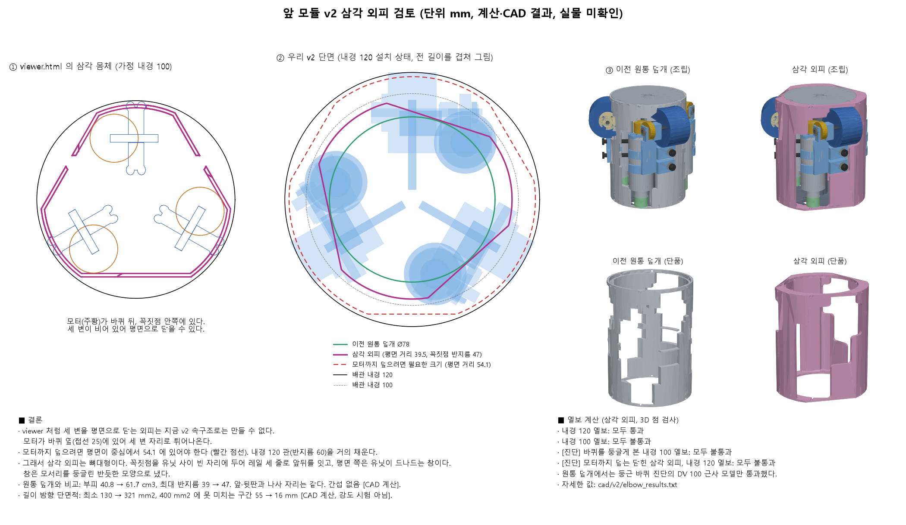

# 앞 모듈 v2 삼각 외피 검토 (2026-11-24)

- 상태: **v2 덮개를 삼각 외피로 바꿨다** (2026-11-24, 강민수 결정). 속구조는 그대로다. 이전 원통 덮개는 `cover_round`로 남겼다.
- 근거: CAD 형상과 계산. 출력물·실물 시험은 없다.
- 단위: mm.



## 배경

저장소 루트의 `viewer.html`(삼각 몸체 조립 검토, 가정 내경 100)은 몸체 단면이 둥근 삼각형이다. 세 변은 평면이고 세 꼭짓점에 바퀴가 있다. 이 모양을 v2 앞 모듈의 외피에 쓸 수 있는지 검토했다. 원통 덮개의 창이 들쭉날쭉해 보기 좋지 않다는 점도 함께 다뤘다.

`viewer.html`의 형상에서 읽은 값:
- 외장: 평면까지 거리 39, 꼭짓점 쪽 둥근 부분 반지름 48, 길이 175.
- 모터는 바퀴 뒤, 꼭짓점 안쪽에 배관과 나란히 놓여 있다. 세 변 쪽에는 튀어나오는 부품이 없다.

## 결론

1. **viewer처럼 세 변을 평면으로 닫는 외피는 지금 v2 속구조로는 만들 수 없다.**
   - v2는 모터가 바퀴 옆(접선 방향 25)에 있다. 모터가 세 변 자리로 튀어나온다.
   - 내경 120 설정에서 모터와 지지판까지 덮으려면 평면이 중심에서 52~54.1에 있어야 한다. 반지름 60인 관을 거의 채운다.
   - 이 크기의 닫힌 외피는 내경 120 엘보를 지나지 못한다 (아래 진단).
2. **뼈대형 삼각 외피는 만들 수 있고, 이것을 v2 덮개로 정했다.** 꼭짓점을 유닛 사이 빈 자리에 두어 레일 세 줄로 앞뒤를 잇고, 평면은 바퀴 유닛 쪽에 둔다. 유닛은 평면의 창으로 드나든다.
   - viewer는 바퀴가 꼭짓점에 있다. 우리 구조에서는 유닛 사이에만 앞뒤를 잇는 살이 설 수 있어서, 그 자리를 꼭짓점으로 써야 삼각 모양이 나온다.
   - 처음에는 평면을 유닛 사이에 두는 안(평면 거리 45, 둥근 부분 47)을 만들었다. 평면 길이가 27뿐이라 거의 원형으로 보여서 버렸다.
3. **창 모양이 반듯해졌다.** 원통 덮개는 부품이 지나는 자리를 그대로 파내서 창이 들쭉날쭉하다. 삼각 외피는 유닛마다 모서리를 둥글린 창 하나로 정리했다.
   - 원통(Ø78)에서는 같은 창을 낼 수 없다. 창 가장자리를 직선으로 정리하면 유닛 사이에 남는 자리가 반지름 40.75부터 시작해서, 반지름 39인 원통에는 앞뒤를 잇는 살이 남지 않는다.
4. **대가:** 외피가 커지고 무거워진다. 내경 100 엘보는 더 불리해진다. 아래 표 참조.

## 삼각 외피 (`cover`)

스크립트: [cad/v2/front_module_v2.py](cad/v2/front_module_v2.py)의 `cover()`. 출력 파일: `cad/v2/stl/cover.stl`, `cad/v2/step/cover.step`.

- 바깥 모양: 세 평면(중심에서 39.5) ∩ 원(반지름 47)인 둥근 삼각형. 평면 길이 50.9, 꼭짓점 둥근 부분은 각 54°. 벽 두께 3.
  - viewer 외장은 평면 39, 둥근 부분 48이다. 비율이 거의 같다.
- 꼭짓점 방향: 유닛 사이 빈 자리 쪽이다. 바퀴에서 모터 쪽으로 78° 돌아간 방향이다.
- 평면 방향: 바퀴 유닛 쪽이다. 평면의 법선은 바퀴 방향에서 모터 쪽으로 18° 돌아가 있다. 모터가 바퀴 옆에 있어 유닛의 중심이 그만큼 치우쳐 있기 때문이다.
- 앞·뒷판(Ø74)과 나사 자리(M2 12개)는 원통 덮개와 같다. 덮개만 바꿔 끼우면 된다.
- 창: 유닛마다 하나, 평면에 뚫린다. 구간마다 부품이 실제로 지나는 폭만큼만 뚫었다 (뒤부터 모터 폭 → 귀 + 모터 폭 → 허브 + 모터 폭 → 허브 + 웜기어 폭 → 바퀴 폭). 모서리 둥글림 3.
  - 2026-11-25 보강: 처음에는 가운데 58.5 구간을 유닛 전체 폭으로 한 번에 뚫어 레일 세 줄만 남았다. 약해 보인다는 의견에 따라 창을 구간별 폭으로 줄였다.
- 레일(꼭짓점을 따라 앞뒤를 잇는 줄): 바깥 폭 약 24.8, 두께 1.5~6.25, 단면적 107 mm² [CAD 형상에서 잰 값]. 안쪽을 채워 두껍게 했다.
- 조립 순서는 원통 덮개와 같다. 덮개를 먼저 씌우고 유닛을 창으로 끼운다.

## 비교 [CAD 계산]

| 항목 | 원통 덮개 `cover_round` | 삼각 외피 `cover` |
| --- | --- | --- |
| 최대 반지름 | 39 | 47 |
| 내경 100 직관과의 틈 | 11 | 3 (꼭짓점), 10.5 (평면 가운데) |
| 부피 | 40.8 cm³ | 61.7 cm³ |
| PLA 무게 (밀도 1.24 g/cm³, 속 100 % 가정) [추정] | 약 51 g | 약 77 g |
| 길이 방향 최소 단면적 (1 mm 간격) | 130 mm² | 321 mm² |
| 단면적이 400 mm²에 못 미치는 구간 길이 | 55 | 16 |
| 창 모양 | 부품 경로를 그대로 파냄 | 평면마다 둥근 모서리 창 하나 (구간별 폭) |
| 부품 간섭 (행정 6위치) | 없음 | 없음 |
| 창이 부품 경로(행정 + 끼우는 경로, 여유 1)를 포함 | 포함 (그 경로로 파냄) | 포함 (겹침 0 mm³) |
| 내경 120 엘보 (DV 125 근사 / 각진 모서리) | 통과 / 통과 | 통과 / 통과 |
| 내경 100 엘보, 짧은 봉 (DV 100 근사 / 각진 모서리) | 불통과 / 불통과 (축 각도 36°, 33°에서 막힘) | 불통과 / 불통과 (6°, 9°에서 막힘) |
| 내경 100 엘보, 바퀴를 둥글게 본 진단 | 통과 / 불통과 | 불통과 / 불통과 |

- 원통 덮개의 값은 커밋 `4adadda`의 `cad/v2/check_results.txt`, `cad/v2/elbow_results.txt`에서 가져왔다.
- 삼각 외피의 값은 지금 `cad/v2/check_results.txt`, `cad/v2/elbow_results.txt`에 있다.
- 엘보 계산 방법과 한계는 [v2 검토 문서 3절](2026-11-20-앞모듈_v2_호환_검토.md)과 같다. 정적 형상 검사이며 실물 엘보 시험이 필요하다.

## 닫힌 삼각 외피 진단 [계산]

모터까지 안에 넣는 창 없는 삼각 외피를 덮개 자리에 놓고 내경 120 엘보만 계산했다 (`python figures/앞모듈_v2_검토.py --closed-shell`).

| 닫힌 외피 | DV 125 근사 | 각진 모서리 |
| --- | --- | --- |
| 법선 30° (viewer 방향), 평면 거리 54.1, 둥근 부분 58 | 불통과 (축 각도 3°에서 막힘) | 불통과 (6°) |
| 법선 20°, 평면 거리 52, 둥근 부분 57 | 불통과 (6°) | 불통과 (12°) |

- 평면 거리는 내경 120 설정에서 모터·지지판이 닿지 않는 거리에 여유 1과 벽 1.5를 더한 값이다.
- 닫힌 삼각 외피를 쓰려면 모터를 꼭짓점 안쪽으로 옮기는 구조 변경이 필요하다. 웜 직결, 가이드봉 위치, 모듈 길이가 함께 바뀌므로 v2 범위 밖이다. 검토하지 않았다.

## 남은 문제

- 강도는 확인하지 않았다. 단면적 비교는 강도 시험이 아니다. z −21 ~ −5.5의 약 16 구간은 레일 세 줄(각 107 mm²)만 앞뒤를 잇는다.
- 세워서 출력하면 층이 레일을 가로지른다. 층 사이 접착이 약점이 되므로 출력해서 휘거나 갈라지는지 확인해야 한다.
- 내경 100 직관에서 꼭짓점의 틈이 3으로 줄어든다. 가이드봉 끝(반지름 47)과 같은 수준이다.
- 내경 100 엘보는 원통 덮개보다 불리하다. 내경 100 엘보를 다시 검토하게 되면 `cover_round`로 돌아가야 한다.
- 무게가 약 26 g 늘어난다 [추정].
- `viewer.html`은 저장소에 커밋되지 않은 파일이었고 2026-11-26에 지웠다. 위 수치는 2026-11-24에 있던 파일에서 읽었다. 그림 ①에 쓰는 단면 선분만 `figures/앞모듈_v2_삼각외피_viewer단면.json`에 남겼다.

## 다시 만들기

```
cd docs/강민수/cad/v2
python front_module_v2.py                    # cover(삼각)·cover_round STL·STEP, check_results.txt
cd ../../figures
python 앞모듈_v2_검토.py                      # elbow_results.txt, 엘보 그림 (10분 이상)
python 앞모듈_v2_검토.py --round-wheel        # 둥근 바퀴 진단을 덧붙임
python 앞모듈_v2_검토.py --closed-shell       # 닫힌 삼각 외피 진단을 덧붙임
python 앞모듈_v2_삼각외피_draw.py              # 비교 그림
```
