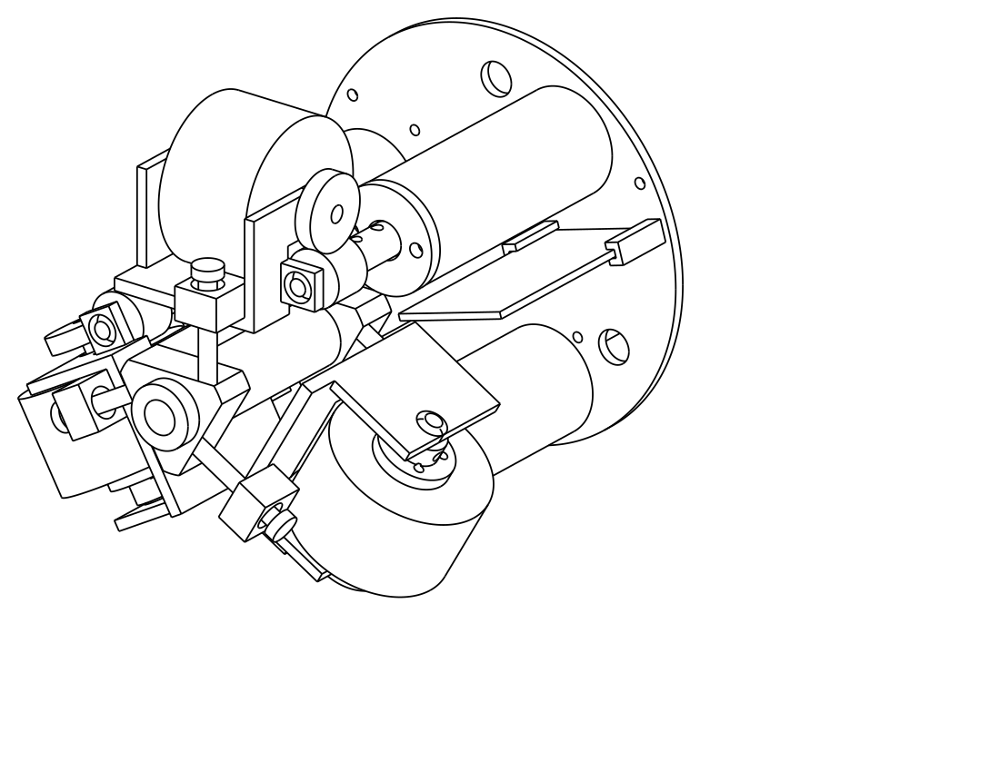
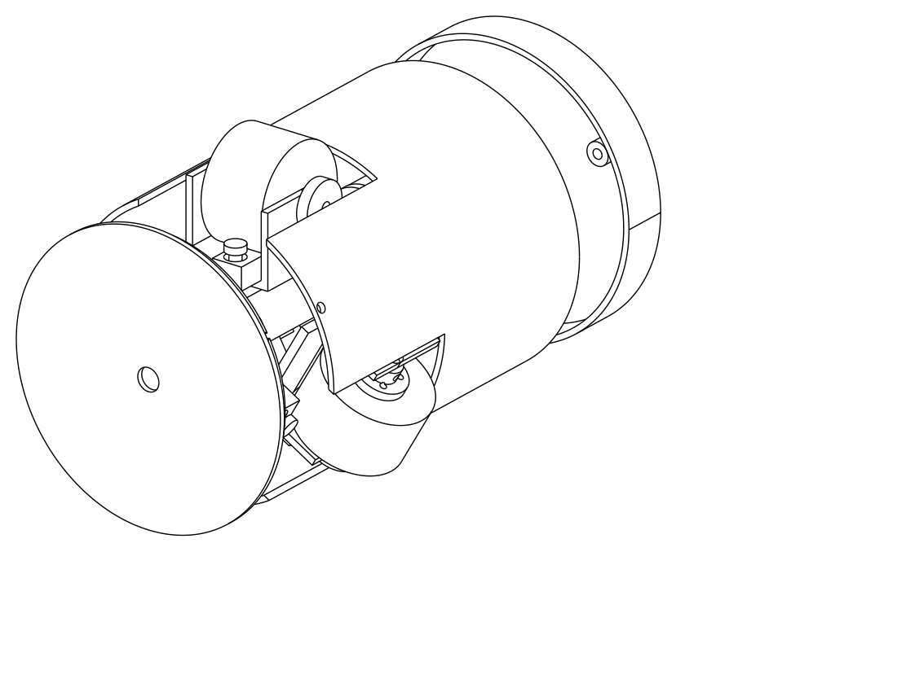

# 앞 모듈 CAD (B안, 배관 내경 120) — 1차 모델

- 작성: 2026-11-19. CadQuery 스크립트 `front_module.py` 로 만든 모델. 실행: `python front_module.py <출력 폴더>` (STL·STEP 출력, 간섭 검사 결과를 함께 출력).
- 구성: 모터 3 + 바퀴 유닛 3 + ESP32(모터 사이 칸) + MDD3A 1개(뒤칸). Pi Zero 2 W 는 뒤 마디.
- 전체 길이 142 (앞 덮개 2 + 몸체 124 + 뒤 덮개 16), 외경 100.
- 간섭 검사: 스프링 이동 범위(+2, 0, −3.4) 전체에서 부품끼리 겹침 없음 (스크립트 계산).
- **출력 전 확인이 필요한 가정값**: 부싱 바깥지름 7, 축 베어링 4×7, 웜기어(모듈 0.8·20T·축간 14, 웜 바깥지름 13.6), 모터 고정 나사 M3 2개 간격 17. 끼워맞춤 공차는 넣지 않았으니 프린터에 맞춰 구멍을 조정할 것.

## 출력 부품 (`stl/`, `step/`)

| 파일 | 수량 | 크기 (mm) | 설명 |
| --- | --- | --- | --- |
| `slider` | 3 | 54 × 30 × 60 | 바퀴 유닛 몸체. 축 지지판 2개, 부싱 자리 2개, 모터 고정판, 웜 축 베어링 자리 일체 |
| `hub` | 3 | Ø18 × 8 | 옴니휠 ↔ 바퀴 축. M2 × 4 (PCD 12), M3 고정 나사 |
| `sleeve` | 3 | Ø8 × 14 | 모터 축 ↔ 웜 축(Ø4 봉) 연결. M3 고정 나사 2개 |
| `spine` | 1 | Ø95 × 124 | 가운데 기둥(바깥 15 / 안 8) + 받침 블록 2개 + 뒤 플랜지. 가이드봉 구멍 6개, MDD3A 받침 4개, ESP32 홈 |
| `shell` | 1 | Ø100 × 124 | 몸체 외피. 바퀴 창 3개가 앞으로 열려 있음 |
| `front_cap` | 1 | Ø100 × 5.5 | 앞 덮개. 기둥 끝을 잡고, 외피 앞끝 3갈래를 묶음. ToF 는 앞면에 부착 |
| `rear_cap` | 1 | Ø100 × 16 | 뒤 덮개(드라이버 칸). 가운데 구멍으로 관절 쪽 배선 |

`step/front_module_assembly.step` 은 구매품(모터·바퀴·기어·봉·보드)을 단순 형상으로 넣은 조립 모델.

## 조립 순서

1. `spine` 의 받침 블록 구멍에 가이드봉(Ø4 × 31) 6개를 박는다.
2. `slider` 에 부싱 2개, 축 베어링, 바퀴 축 + 옴니휠 + `hub` + 웜휠, 모터 + `sleeve` + 웜 축 + 웜을 조립한다.
3. 봉마다 스프링(C202)을 끼우고 `slider` 를 봉에 꽂은 뒤, 봉 끝에 스토퍼(Ø4 축 고정 링)를 단다. 3유닛 반복.
4. ESP32 를 플랜지의 홈에 끼우고, MDD3A 를 플랜지 뒷면 받침에 M2.5 나사로 고정한다.
5. 이 뭉치를 `shell` 앞쪽에서 밀어 넣는다 (바퀴는 창을 따라 들어감). 플랜지가 외피 뒤쪽 턱에 닿는다.
6. `rear_cap` 을 대고 M3 긴 나사 3개로 뒤 덮개–외피 턱–플랜지를 한 번에 조인다.
7. `front_cap` 을 끼우고 옆에서 M3 나사 3개로 고정한다.

## 아직 안 된 것

- ToF 센서·관절 연결부 형상 (보드와 관절 치수가 정해지면 추가)
- 모터 뒤쪽 받침 (지금은 고정판 한쪽으로만 잡음)
- 나사 자리의 인서트 너트 구멍 치수, 출력 방향·서포트 검토

