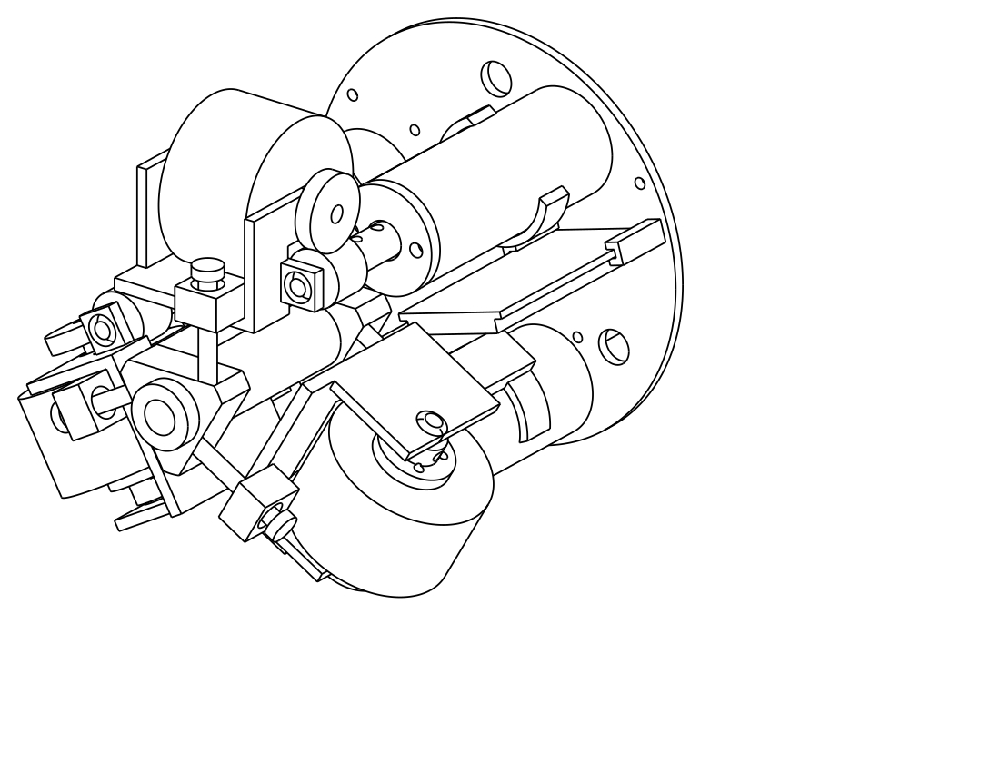
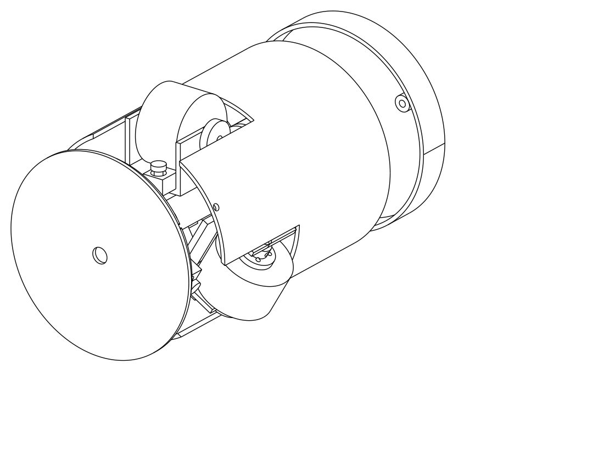

# 앞 모듈 CAD (B안, 배관 내경 120) — 1차 모델 (v1, 보관용)

> 2026-11-23: v1 파일을 `cad/`에서 `cad/v1/`로 옮겼다. 현재안은 [v2](../v2/README.md)다. 이 폴더는 비교·기록용이며 출력하지 않는다.

> 2026-11-20: 이 모델은 내경 120 전용이다. 내경 100~120 호환·엘보 통과 조건에서는 가이드 행정(5.4 mm)과 Ø100 외피·길이 142가 맞지 않는다. 2D 엘보 계산에서 내경 120 엘보도 통과하지 못했다. 대안 배치는 [v2 호환 검토](../../2026-11-20-앞모듈_v2_호환_검토.md)에 있다. v2 배치도(내경 120 시연, C202 + 스페이서 9)는 [figures/2026-11-21-앞모듈_배치도_v2.png](../../figures/2026-11-21-앞모듈_배치도_v2.png)이다. **v2 CAD는 [v2/README.md](../v2/README.md)** (2026-11-22). 이 파일과 `stl/`·`step/`·`preview/`는 v1이다.

- 작성: 2026-11-19. CadQuery 스크립트 `front_module.py` 로 만든 모델. 실행: `python front_module.py <출력 폴더>` (STL·STEP 출력, 간섭 검사 결과를 함께 출력).
- 구성: 모터 3 + 바퀴 유닛 3 + ESP32(모터 사이 칸) + MDD3A 1개(뒤칸). Pi Zero 2 W 는 뒤 마디.
- 전체 길이 142 (앞 덮개 2 + 몸체 124 + 뒤 덮개 16), 외경 100.
- 기존 스크립트는 단순화한 모터 형상으로 스프링 변위 +2, 0, −3.4 mm에서 간섭을 검사했다. 교체한 FIT0522의 도면으로 다시 계산한 결과는 아래와 같다.
- **출력 전 확인이 필요한 가정값**: 부싱 바깥지름 7, 축 베어링 MF74ZZ(4×7×2.5, 플랜지 Ø8.2×0.6), 웜기어(모듈 0.8·20T·축간 14, 웜 바깥지름 13.6), 모터 고정 나사 M3 2개 간격 16~18(긴 구멍). 끼워맞춤 공차는 넣지 않았으니 프린터에 맞춰 구멍을 조정할 것.

## 실물 도착 전 수정 (2026-11-19)

구매품이 아직 없는 상태에서 고칠 수 있는 항목만 반영했다. 바뀐 출력 파일은 `slider`, `sleeve`, 조립 STEP이다. 이전 형상은 커밋 `b0ac54f`의 `front_module.py`로 재현할 수 있다.

| 항목 | 이전 | 변경 | 근거 |
| --- | --- | --- | --- |
| 바퀴 축 베어링 자리 | 구멍 Ø7.1이 지지판 위끝에 닿음 (위쪽 벽 0 mm) | 구멍 둘레에 Ø10.1 보강, 위쪽 벽 1.5 mm. 슬라이더 높이 32.25 → 33.75 | [계산] |
| 바퀴 축 베어링 | 4×7 가정 | 플랜지형 MF74ZZ ×2/유닛을 가정. 플랜지는 지지판 바깥면(A쪽 x=−22.5, B쪽 x=14.5)에 닿게 끼움 | 제안, 팀 결정 아님. 치수는 판매 일반 규격 |
| 모터 고정 나사 | 둥근 구멍, 간격 17 | 간격 16~18을 받는 긴 구멍 (슬롯 바깥 끝에서 고정판 가장자리까지 1.95 mm) | 같은 25 mm 계열 JGA25-370 판매 사양이 M3, 17 mm. FIT0522 도면에는 없음 [미확인] |
| 슬리브 뒤끝 | 장착면 +2 (z=−21) | 장착면 +3 (z=−20), 길이 14 → 13 | FIT0522 Ø7 돌출부 2.5 mm와 0.5 mm 띄움 [도면·계산] |

재생성 후 `front_module.py` 간섭 검사 결과(Windows, CadQuery 2.8.0): 슬리브–돌출부 겹침은 없어졌고, 베어링 모형을 추가해도 새 간섭은 없다. 남은 것은 아래 표의 엔코더–플랜지(약 150 mm³, 변위 3조건 모두)와 출력축–웜 축(29 mm³)이다. 둘 다 축 배치와 뒤 플랜지 형상을 정해야 고칠 수 있다.

`assembly_check.py`도 수정 형상(FIT0522·베어링 포함)으로 다시 실행했다. 내부 뭉치 앞쪽 삽입, 앞·뒤 덮개 삽입, 모터 뒤쪽 삽입은 모든 위치에서 겹침이 없었다. 최종 위치에서는 세 유닛 모두 변위 3조건에서 모터–기둥(엔코더–플랜지)만 걸렸다. 단순 형상·이산 위치 검사라는 한계는 [ASSEMBLY_REVIEW.md](ASSEMBLY_REVIEW.md)와 같다. `assembly_check_results.txt`는 수정 전 결과로 남겨 둠.

## FIT0522 교체 후 출력 전 확인 사항 (2026-11-19)

**FIT0522와 출력 부품이 닿는 곳이 있고, 구매품인 출력축과 웜 축도 서로 겹친다.** 세 번째 줄(돌출부–슬리브)은 위 수정으로 해소했다. 조립 STEP과 시험용 모터 STL에는 도면의 엔코더·돌출부·출력축을 반영했다. 아래 값은 모터 장착면 기준 CAD 계산값이다.

| 맞닿는 부품 | FIT0522 도면 치수 | 현재 CAD 치수 | 축 방향 겹침 |
| --- | --- | --- | --- |
| 뒤 엔코더와 플랜지 | 장착면에서 뒤끝까지 약 63 mm (23 + 참고 치수 40) | 플랜지까지 62 mm | 약 1 mm |
| 출력축과 웜 축 | 장착면에서 축 끝까지 14.5 mm | 웜 축 시작점까지 12 mm | 2.5 mm |
| ~~모터 앞 돌출부와 슬리브 입구~~ | Ø7 mm 돌출부 길이 2.5 mm | 슬리브 시작점까지 3 mm (수정 전 2 mm) | 없음 (0.5 mm 띄움) |

돌출부는 FIT0521 도면에도 있었고 기존 CAD에서 누락됐다. 엔코더 쪽 약 1 mm는 플러그와 전선을 제외한 값이다. 반지름 방향 변위 −3.4, 0, +2 mm에서 모두 플랜지와 겹쳤다. 필요한 배선 공간은 실제 플러그를 끼우고 전 이동 구간에서 전선이 당기거나 눌리는 위치를 재야 정할 수 있다.

슬리브 앞끝은 z=−7 mm, 기존 웜 축 뒤끝은 −11 mm여서 물림 길이는 4 mm다 (슬리브 뒤끝을 −20으로 옮겨도 앞끝은 그대로). 멈춤나사 구멍(중심 −10 mm, 지름 2.6 mm)이 이음매에 걸친다. FIT0522 축 끝(−8.5 mm)에 맞춰 웜 축 뒤끝을 옮기면 물림은 1.5 mm이고 나사 중심은 웜 축을 벗어난다. 슬리브 앞끝에서 웜까지 남은 공간은 2 mm다. 축 길이·슬리브·웜 위치와 뒤 플랜지 형상은 함께 재설계할 항목이다.

드라이버 배치는 팀 결정 전이다. 기구 B안과 조립 키트는 앞 MDD3A 한 개가 모터 두 개를 맡고 뒤 마디의 드라이버가 나머지 앞 모터를 맡는 구성이다. [전자 초안](../../electronics/README.md)은 앞에 두 개를 두는 조건으로 작성됐다.

모터 고정 나사 M3 두 개의 중심 간격은 FIT0522 도면에 없다. 고정판은 16~18 mm 긴 구멍으로 바꿨지만, 실물의 나사 규격·중심 간격·허용 체결 깊이는 확인해야 한다. [DFRobot FIT0522 측면도](https://www.micro-semiconductor.jp/datasheet/04-FIT0522.pdf)

Nexus 14166 바퀴의 중심 구멍은 실물 도면 Ø4.00 mm, 출력 모형 Ø4.2 mm다. 지름 12 mm 원 위의 체결 구멍 네 개도 실물 도면 Ø2.10 mm, 출력 모형 Ø1.6 mm다. 도면에 M2 암나사 표기가 없고 허브 쪽도 통과 구멍이므로 실물에서 나사가 물릴 위치를 확인해야 한다. [Nexus 바퀴 도면](https://www.nexusrobot.com/wp-content/uploads/2016/09/14166-layout.pdf) · [조립 키트 치수 대조](fit_kit/README.md)

## 출력 부품 (`stl/`, `step/`)

| 파일 | 수량 | 크기 (mm) | 설명 |
| --- | --- | --- | --- |
| `slider` | 3 | 56 × 34 × 96 | 바퀴 유닛 몸체. 축 지지판 2개(MF74ZZ 자리), 부싱 자리 2개, 모터 고정판(M3 긴 구멍), 모터 뒤 받침, 웜 축 베어링 자리 일체 |
| `hub` | 3 | Ø18 × 8 | 옴니휠 ↔ 바퀴 축. M2 × 4 (PCD 12), M3 고정 나사 |
| `sleeve` | 3 | Ø8 × 13 | 모터 축 ↔ 웜 축(Ø4 봉) 연결. M3 고정 나사 2개 |
| `spine` | 1 | Ø95 × 124 | 가운데 기둥(바깥 15 / 안 8) + 받침 블록 2개 + 뒤 플랜지. 가이드봉 구멍 6개, MDD3A 받침 4개, ESP32 홈 |
| `shell` | 1 | Ø100 × 124 | 몸체 외피. 바퀴 창 3개가 앞으로 열려 있음 |
| `front_cap` | 1 | Ø100 × 5.5 | 앞 덮개. 기둥 끝을 잡고, 외피 앞끝 3갈래를 묶음. ToF 는 앞면에 부착 |
| `rear_cap` | 1 | Ø100 × 16 | 뒤 덮개(드라이버 칸). 가운데 구멍으로 관절 쪽 배선 |

`step/front_module_assembly.step` 은 구매품(모터 FIT0522·바퀴·기어·봉·보드·바퀴 축 베어링)을 단순 형상으로 넣은 조립 모델.

## 조립 순서

1. `spine` 의 받침 블록 구멍에 가이드봉(Ø4 × 31) 6개를 박는다.
2. `slider` 에 부싱 2개, 축 베어링, 바퀴 축 + 옴니휠 + `hub` + 웜휠, 모터 + `sleeve` + 웜 축 + 웜을 조립한다.
3. 봉마다 스프링(C202)을 끼우고 `slider` 를 봉에 꽂은 뒤, 봉 끝에 스토퍼(Ø4 축 고정 링)를 단다. 3유닛 반복.
4. ESP32 를 플랜지의 홈에 끼우고, MDD3A 를 플랜지 뒷면 받침에 M2.5 나사로 고정한다.
5. 이 뭉치를 `shell` 앞쪽에서 밀어 넣는다 (바퀴는 창을 따라 들어감). 플랜지가 외피 뒤쪽 턱에 닿는다.
6. `rear_cap` 을 대고 M3 긴 나사 3개로 뒤 덮개–외피 턱–플랜지를 한 번에 조인다.
7. `front_cap` 을 끼우고 옆에서 M3 나사 3개로 고정한다.

## 모터 뒤 받침 (2026-11-19 추가)

- `slider` 에 팔(4.7 × 11, 길이 43)과 C형 고리(안지름 25.4, 두께 2, 폭 8)를 붙였다. 고리는 모터 캔 중간(고정판에서 35~43 mm 뒤)을 잡는다.
- 몸체 벽 쪽은 여유가 0.9 mm 뿐이라 고리를 그쪽으로 열어 두었다(약 247° 감쌈). 모터는 뒤에서 고리로 밀어 넣어 고정판에 나사로 조인다.
- C형 고리는 슬라이더에 고정되어 모터와 함께 움직인다. FIT0522를 장착할 때는 위 표의 엔코더와 플랜지 사이 간섭도 고려해야 한다.

## ESP32

- 보드는 디바이스마트 [ESP32 DevKitC WROOM-32D V4 (CMODULE-40)](https://www.devicemart.co.kr/goods/view?no=15313999) 로 본다. 치수는 Espressif DevKitC V4 값(48.3 × 27.9, 안테나 포함 54.4)을 썼고, 판매 페이지에는 치수 표기가 없다.
- 홈은 기판 양쪽 가장자리를 잡는 방식이라 **핀헤더가 달려 있으면 끼워지지 않는다.** 헤더를 떼고 선을 직접 납땜하거나, 헤더를 살리려면 홈 모양을 바꿔야 한다.

## 아직 안 된 것

- ToF 센서·관절 연결부 형상 (보드와 관절 치수가 정해지면 추가)
- 나사 자리의 인서트 너트 구멍 치수, 출력 방향·서포트 검토

아래 그림은 FIT0522·베어링 반영 전 형상이다 (`preview.py`에 필요한 cairosvg가 현재 환경에 없어 다시 그리지 않음).

