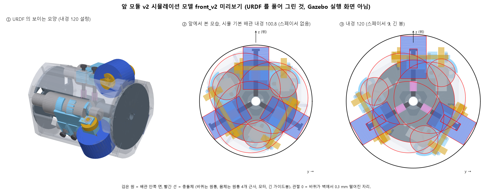
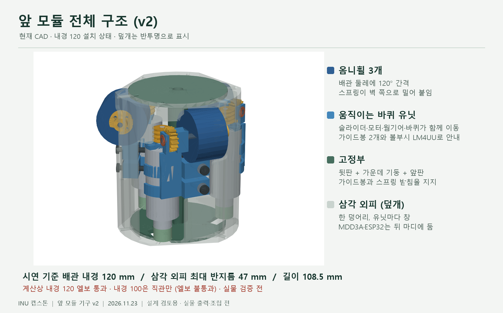
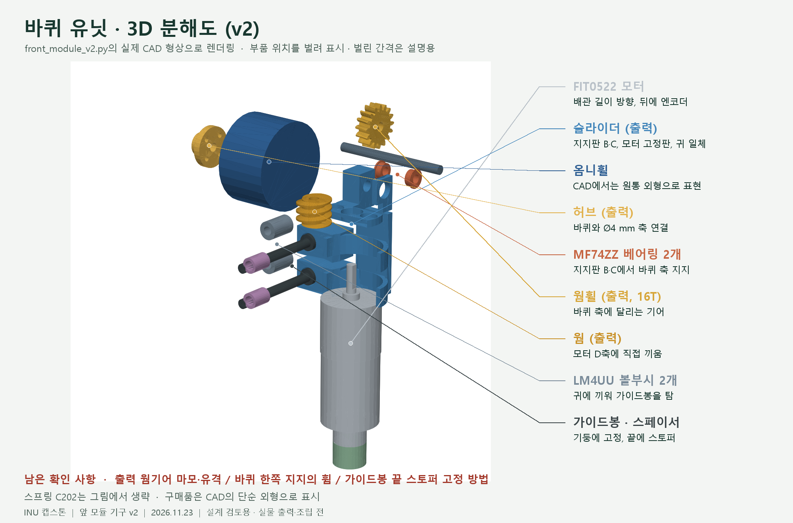
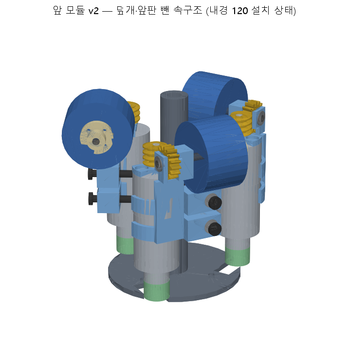
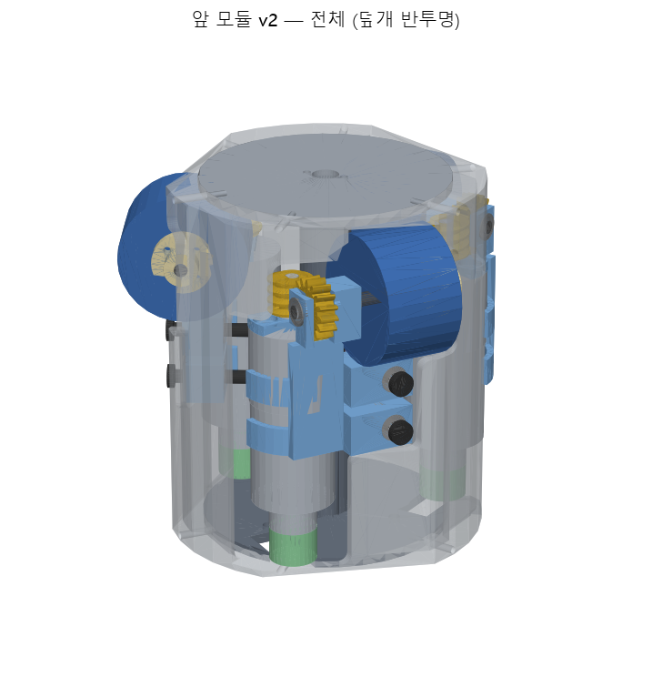

# 앞 모듈 CAD v2 — 내경 120 시연 기준 (내경 100은 직관만 계산상 가능)

- 작성: 2026-11-22. 수정: 2026-11-23, 2026-11-24
  - 바퀴 축 베어링 하나를 지지판 C로 옮겼다.
  - 덮개를 한 덩어리로 바꿨다.
  - 구매한 부싱 LM4UU(4×8×12) 치수를 반영했다.
  - 웜·웜휠을 출력 부품(모듈 1.0, 1:16)으로 추가했다.
  - 2026-11-24: 덮개를 원통(Ø78)에서 삼각 외피로 바꿨다. 이전 원통 덮개는 `cover_round`로 남겼다. 근거는 [삼각 외피 검토](../../2026-11-24-앞모듈_v2_삼각외피_검토.md).
- CadQuery 스크립트 [front_module_v2.py](front_module_v2.py)로 만든 모델이다. **실물 출력·조립은 아직 하지 않았다.**
- 근거:
  - 배치 검토: [2026-11-20-앞모듈_v2_호환_검토.md](../../2026-11-20-앞모듈_v2_호환_검토.md)
  - 부품·구매 현황: [2026-11-23-앞모듈_v2_실현성_부품점검.md](../../2026-11-23-앞모듈_v2_실현성_부품점검.md)
  - 배치도: [2026-11-21-앞모듈_배치도_v2.png](../../figures/2026-11-21-앞모듈_배치도_v2.png)
  - 유닛 그림: [2026-11-21-서스펜션_유닛_v2.png](../../figures/2026-11-21-서스펜션_유닛_v2.png)
  - 그림의 치수와 덮개 모양은 이 스크립트에서 읽는다.
- 대화에서 정한 조건 (2026-11-21~23):
  - 내경 120 시연 기준, C202 + 스페이서 9 mm
  - 웜을 모터 축에 직결하고 스러스트 와셔 사용
  - 덮개는 삼각 외피 (2026-11-24, 속구조는 그대로)
  - MDD3A·ESP32는 뒤 마디
  - 웜기어는 시제품 단계에서 출력해서 쓴다
- v1(`../v1/`)은 비교용으로 그대로 둔다.

## 실행

```
python front_module_v2.py              # stl/, step/ 출력 + 간섭 검사 → check_results.txt (약 10분)
python front_module_v2.py --no-check   # 출력만
python preview_v2.py                   # preview/*.png (matplotlib 그림, 확인용)
python ../../figures/앞모듈_v2_설명그림_draw.py   # figures/ 에 설명·발표용 그림 4장 (Pillow 필요)
python ../../figures/앞모듈_v2_삼각외피_draw.py   # figures/ 에 삼각 외피 비교 그림
python urdf_export.py                  # 시뮬레이션 모델 front_v2 의 메시·CAD 값 (아래 "시뮬레이션 모델")
python -X utf8 urdf_check.py           # 그 모델 검사 → urdf_check_results.txt, 미리보기 그림 (xacro 필요)
```

확인 환경: Windows, Python 3.11.9, CadQuery 2.8.0, xacro 2.1.1 (`pip install xacro`).

## 출력 부품 (`stl/`, `step/`)

| 파일 | 수량 | 크기 (mm) | 설명 |
| --- | --- | --- | --- |
| `slider` | 3 | 45.8 × 24.1 × 53.0 | 바퀴 유닛 몸체. 한 덩어리로 출력:<br>· 지지판 B (바퀴 쪽 베어링), 지지판 C (웜휠 바깥 베어링) — 베어링 간격 15<br>· 모터 고정판 (M3 긴 구멍 16~18, 머리 자리 깊이 1.7)<br>· 모터 위 막대, 모터 위쪽 반원 받침 2개<br>· 귀 2개 (LM4UU 자리: 구멍 Ø8.1, 높이 12, 벽 1.95) |
| `worm` | 3 | Ø14 × 10 | 한 줄 웜, 모듈 1.0, 피치원 Ø12. D자 구멍(Ø4.2, 평면까지 1.6)으로 FIT0522 D축에 끼움. M3 무두 멈춤나사 파일럿 Ø2.5 |
| `wormwheel` | 3 | Ø18 × 5.5 | 16T. 비틀림각 4.76° 헬리컬 기어로 근사한 웜휠. Ø4.1 축 구멍, 이 사이 골에 M3 무두 멈춤나사 파일럿 |
| `hub` | 3 | Ø18 × 8 | 옴니휠 ↔ 바퀴 축. v1과 같은 형상 (M2×4 PCD 12, M3 멈춤나사) |
| `spacer` | 6 | Ø6.5 × 9 | 가이드봉에 끼워 스프링 받침을 9 mm 올림. 내경 100 설정에서는 뺀다 |
| `base` | 1 | Ø74 × 105.5 | 뒷판 + 가운데 기둥(Ø15, 안 Ø8) + 스프링 받침 블록 한 덩어리.<br>· 가이드봉 압입 구멍 6 (Ø3.9, 깊이 4.5)<br>· 모터선 홈 3, 관절 연결 M3 3 (관절 미정)<br>· 덮개 M2 파일럿, 앞판 M2 파일럿 |
| `front_cap` | 1 | Ø74 × 3 | 앞판. 가운데 배선 구멍 Ø8, 기둥 끝에 M2 2개. ToF 자리는 미정 |
| `cover` | 1 | 90.9 × 92.4 × 108.5 | 삼각 외피 (한 덩어리 덮개), 61.7 cm³. 자세한 내용은 아래 |
| `cover_round` | (대안) | Ø78 × 108.5 | 이전 원통 덮개, 40.8 cm³. `cover` 자리에 그대로 끼울 수 있다. 조립 STEP과 지금 검사에는 넣지 않았다 |

`cover` 형상 (삼각 외피):
- 바깥은 세 평면(중심에서 39.5 mm) ∩ 원(반지름 47 mm)인 둥근 삼각형이다. 평면 길이 50.9 mm, 꼭짓점 둥근 부분은 각 54°. 벽 두께 3 mm. 양 끝 고리가 앞뒤 판(Ø74) 가장자리를 감싼다.
- 꼭짓점은 유닛 사이 빈 자리에 둔다 (바퀴에서 모터 쪽으로 78°). 평면은 바퀴 유닛 쪽을 지나고, 유닛은 평면의 창으로 드나든다.
  - 평면의 법선은 바퀴 방향에서 모터 쪽으로 18° 돌아가 있다. 모터가 바퀴 옆에 있어서 유닛의 중심이 그만큼 치우쳐 있기 때문이다.
- 창은 유닛마다 하나다. 구간마다 부품이 실제로 지나는 폭만큼만 뚫어 살을 남겼다. 뒤부터 모터 폭 → 귀 + 모터 폭 → 허브 + 모터 폭 → 허브 + 웜기어 폭 → 바퀴 폭이다. 모서리는 반지름 3 mm로 둥글렸다.
- 창은 움직이는 부품이 지나가는 공간 + 여유 1 mm를 모두 포함한다. 행정 d −12~+3과, 유닛을 바깥에서 끼워 넣는 경로(d +40까지)다. 스크립트가 겹침 0 mm³를 확인한다.
- 유닛 사이에는 꼭짓점을 따라 레일 세 줄이 남아 앞뒤를 잇는다. 레일은 바깥 폭 약 24.8 mm, 두께 1.5~6.25 mm, 단면적 107 mm²다 [CAD 형상에서 잰 값].
- 길이 방향 단면적(1 mm 간격)은 최소 321 mm²다. 레일 세 줄만 남는 구간은 z −21 ~ −5.5의 약 16 mm다. 원통 덮개는 최소 130 mm², 400 mm²에 못 미치는 구간이 55 mm다 [CAD 계산, 강도 시험 아님].
- 앞뒤 판에 M2 12개로 고정한다. 나사 자리는 원통 덮개와 같다.

`cover_round` (이전 원통 덮개):
- 양 끝은 두께 2 mm, 그 사이는 부품이 지나지 않는 곳만 안쪽으로 채워 두께 4 mm(반지름 35~39)다. 창은 부품이 지나는 공간을 그대로 파낸 모양이다.
- 원통 덮개로 한 간섭 검사와 엘보 계산 결과는 커밋 `4adadda`의 `check_results.txt`, `elbow_results.txt`에 있다.
- 두 덮개의 비교: [삼각 외피 검토](../../2026-11-24-앞모듈_v2_삼각외피_검토.md)

모든 출력 부품은 유효한 단일 솔리드다(스크립트 확인). 끼워맞춤 공차는 구멍에만 0.05~0.1 mm 넣었다. 프린터에 맞춰 조정해야 한다.

출력 재료는 PLA다 (2026-11-25, 쓸 수 있는 재료가 PLA뿐). 아래는 일반적인 권장이며 이 부품으로 시험한 값이 아니다.
- 덮개·슬라이더: 벽 4줄 이상. 덮개는 세워서 출력하므로 층 사이 접착이 약점이다. 노즐 온도를 권장 범위의 위쪽으로 잡고 냉각 팬을 줄이면 층이 더 잘 붙는다.
- 웜·웜휠·허브·스페이서: 속 채움 100 %, 층 높이 0.12~0.16 mm.
- PLA는 약 55~60 °C에서 물러진다 [일반 물성]. 모터가 막힌 채로 오래 전류가 흐르면 모터 주변(슬라이더 받침, 웜)이 변형될 수 있다. 막힘 감지와 전류 제한이 더 중요해진다.
- PLA는 충격에 잘 깨진다. 덮개 레일과 슬라이더 귀는 떨어뜨리거나 비틀 때 먼저 깨질 수 있는 곳이다.

## 출력 웜기어

| 항목 | 값 |
| --- | --- |
| 모듈 / 감속 | 1.0 / 1:16 (한 줄 웜, 웜휠 16T) |
| 축간 거리 | 14 mm (= (12 + 16) / 2). 이전 가정과 같아서 슬라이더 배치는 그대로 |
| 이끝 지름 | 웜 Ø14, 웜휠 Ø18 |
| 웜 리드각 | 4.76° |
| 백래시 | 이 두께를 양쪽에서 0.05 mm씩 줄임 (합 0.10 mm) |
| 맞물림 확인 [계산] | 설치 위상에서 실제 이 형상끼리 겹침 0 mm³. 웜휠을 반 피치 돌리면 겹침 21.3 mm³ (이가 제대로 서로 사이에 들어간다는 확인) |
| 속도 [계산] | 무부하 약 12.5 mm/s (FIT0522 100 rpm ÷ 16, 바퀴 Ø38.1) |

- 재료는 PLA다 (2026-11-25, 쓸 수 있는 재료가 PLA뿐). PETG나 나일론보다 빨리 닳고 열에 약하다고 보고, 예비 세트를 더 출력해 둔다. 조립할 때 그리스를 바른다.
- 출력 방향: 웜은 축을 세워서, 웜휠은 눕혀서.
- 웜휠은 정식 웜휠(오목한 이)이 아니다. 헬리컬 기어로 근사해서 이가 웜에 점 접촉한다. 가벼운 하중의 시제품용이다.
- 고정:
  - 웜은 D자 구멍으로 토크를 받고 M3 무두 멈춤나사로 빠짐을 막는다.
  - 웜휠은 M3 무두 멈춤나사로 고정한다. 바퀴 축의 그 자리에 줄로 평면을 조금 내면 미끄러지지 않는다.
- 웜휠(폭 5.5)이 지지판 B와 C 사이(6.5)에 끼어 있어 바퀴 축의 좌우 위치도 잡는다. 따로 축 칼라를 쓰지 않는다.
- 간섭 검사에서는 웜과 웜휠을 이끝 원통(Ø14, Ø18)으로 보았다.
- 마모·유격·정지 시 잠김은 실물로 확인해야 한다. 예비 세트를 더 출력해 둔다.

## 구매품 (유닛 3개 기준)

구매 여부는 팀 구매리스트(2026-11-17 수정본) 기준이다.

| 부품 | 수량 | 구매 | 메모 |
| --- | --- | --- | --- |
| DFRobot FIT0522 | 3 | ✅ | 앞면 M3 간격은 미확인 → 긴 구멍 |
| Nexus 14166 옴니휠 Ø38.1 | 3 | ✅ | |
| 리니어 볼부시 LM4UU (4×8×12) | 6 | ✅ | 귀에 눌러 끼움 |
| 샤프트 Ø4 × 100 | 6 (12개 구매) | ✅ | 잘라서 가이드봉 42.5 × 6, 바퀴 축 약 51 × 3 |
| 스프링 C202 | 6 (20개 구매) | ✅ | 안지름 > 4 인지 확인 |
| MF74ZZ (4×7×2.5, 플랜지 Ø8.2×0.6) | 6 | ❌ | 지지판 B(바퀴 쪽 면)와 C(바깥 면)에 하나씩, 플랜지가 바깥을 향함 |
| M4 평와셔 (얇은 것) | 3 | ❌ | 스러스트 와셔. 웜과 모터 고정판 사이 (틈 1.5) |
| M3 무두 멈춤나사 (길이 3~4) | 9 | 보유 여부 확인 | 허브 3, 웜 3, 웜휠 3 |
| M2 너트 | 12 | 보유 여부 확인 | 허브–바퀴 |
| 나사 M2·M3 | | 보유 | M3 × 5 낮은 머리 ×6 (모터), M2 ×12 (덮개), M2 ×2 (앞판), M2 ×12 (허브–바퀴) |
| 가이드봉 끝 스토퍼 | 6 | 미정 | 두께 2 mm 이하여야 함. 출력한 캡을 접착하거나 Ø4용 푸시너트. 시중 세트칼라(폭 5)는 봉 끝이 반지름 50까지 올라가 내경 100에서 쓸 수 없음 |

## 조립 순서 (제안, 실물 미검증)

덮개가 한 덩어리라서 덮개를 먼저 씌우고 유닛을 창으로 끼운다.

1. **덮개:** `base`에 `cover`를 앞에서 씌우고 뒷판 가장자리에 M2 6개로 고정한다.
2. **가이드봉:** 덮개 창으로 가이드봉 6개를 받침 블록 구멍에 눌러 끼운다. 접착제 병용을 권한다. 각 봉에 스페이서와 C202를 끼운다.
3. **유닛 조립:** 덮개 밖에서 유닛마다 아래 순서로 조립한다.
   1. 귀 2곳에 LM4UU를 눌러 끼운다.
   2. 모터를 슬라이더 반원 받침 아래쪽에서 넣고, 앞에서 M3 2개로 고정판에 조인다.
   3. 와셔와 웜을 모터 축에 끼우고 멈춤나사로 고정한다.
   4. 지지판 B·C에 MF74ZZ를 하나씩 끼운다.
   5. 웜휠을 B와 C 사이에 위에서 넣는다.
   6. 허브와 바퀴를 M2 4개로 미리 결합한다.
   7. 바퀴 축을 허브·바퀴 → 베어링 B → 웜휠 → 베어링 C 순서로 꽂고, 웜휠 멈춤나사를 조인다.
   - 모터 나사는 웜보다 먼저 조여야 한다. 나사 머리와 웜이 앞에서 보면 겹친다.
4. **유닛 장착:**
   1. 조립한 유닛을 자기 창 쪽 바깥에서 반지름 방향으로 밀어 넣는다. LM4UU가 봉에 끼워진다.
   2. 스프링을 누르며 봉 끝(반지름 45~47)에 스토퍼를 단다.
   3. 모터선은 뒷판 홈으로 뺀다.
5. **앞판:** `front_cap`을 기둥 끝에 M2 2개로 고정하고, 덮개 앞 가장자리를 M2 6개로 고정한다.

## 검사 결과 (`check_results.txt`)

- 검사 위치: 바퀴 축 변위 d = −12(내경 100 −2), −10(내경 100 접촉), −2.91(스프링 한계), 0(내경 120), +1.9(이음부 Ø123.8), +3(스토퍼).
- 스페이서는 d ≥ −2.91에서만 넣었다. 그보다 안쪽은 스페이서를 뺀 내경 100 설정이다.
- 결과 (겹침 0.01 mm³ 초과를 보고):
  - 유닛 내부 부품끼리 겹침 없음. 축–바퀴·웜–웜휠처럼 맞물리거나 끼워지는 쌍은 뺐다.
  - 유닛 0 ↔ 고정부(base·앞판·덮개·가이드봉·스페이서): 6위치 모두 겹침 없음.
  - 유닛 0 ↔ 유닛 1: 위치 6 × 6 = 36조합 모두 겹침 없음. 회전 대칭이라 나머지 쌍을 대표한다.
- 한계:
  - 스프링·나사·배선·공구는 형상에 없다.
  - 이산 위치 검사다.
  - 유닛을 끼워 넣는 경로는 덮개 창 계산에만 넣었고, 따로 충돌 검사하지 않았다.

## 엘보 통과 계산 (`elbow_results.txt`)

실행: `python ../../figures/앞모듈_v2_검토.py` (10분 이상 걸림). 이 CAD의 실제 부품 표면 점을 3D로 검사한다. 방법과 한계는 [v2 검토 문서 3절](../../2026-11-20-앞모듈_v2_호환_검토.md)에 있다.

| 설정 | 내경 120 엘보 (DV 125 근사 / 각진 모서리) | 내경 100 엘보 (DV 100 근사 / 각진 모서리) |
| --- | --- | --- |
| 내경 120 설정 (스페이서 9, 긴 봉), 유닛은 스프링 한계 | 통과 / 통과 | 해당 없음 (이 설정은 내경 100에 쓰지 않음) |
| 스페이서 없음 + 짧은 봉 (끝 37), 유닛은 가장 안쪽 | 통과 / 통과 | **불통과 / 불통과** (축 각도 6°, 9°에서 막힘) |
| 스페이서 없음 + 긴 봉 (끝 47), 유닛은 가장 안쪽 | — | **불통과 / 불통과** (축 각도 6°, 9°에서 막힘) |

- 위 표는 삼각 외피(`cover`)로 계산한 결과다 (2026-11-24).
- 내경 120 시연 조건은 성립한다.
- **내경 100 엘보는 지금 형상으로는 통과하지 못한다.** 내경 100 직관에는 들어간다 (가장 바깥 점 반지름 49.4).
  - 2026-11-23 이전 문서의 "내경 100 엘보 통과"는 2D 단순 외곽 계산 결과였다. 그 외곽이 슬라이더의 모터 위 막대와 지지판 C 모서리를 빠뜨렸다.
  - **삼각 외피로 바꾸면서 내경 100 엘보는 더 불리해졌다.** 원통 덮개에서는 축 각도 18~36°에서 막혔고, 삼각 외피에서는 6~9°에서 막힌다. 외피의 최대 반지름이 39에서 47로 커졌기 때문이다.
  - 위 표는 바퀴를 Ø38.1 × 23 원통으로 본 결과다. 바퀴 가장자리를 반지름 5로 둥글려도 삼각 외피에서는 두 모델 모두 불통과다 (`--round-wheel` 진단). 원통 덮개에서는 이 진단에서 DV 100 근사 모델만 통과했다.
  - 내경 100 엘보를 다시 검토하게 되면 원통 덮개(`cover_round`)로 돌아가고, 슬라이더 바깥 모서리도 줄여야 한다.
- 닫힌 삼각 외피 진단 (`--closed-shell`): 모터까지 덮는 크기(평면 거리 52~54.1)의 창 없는 외피는 내경 120 엘보에서 두 모델 모두 불통과다 (축 각도 3~12°에서 막힘).
- 정적 형상 검사다. 실물 엘보 시험이 필요하다.


## 바퀴 축 베어링 하중 [계산, 정적]

바퀴 하중 11.3 N(내경 120 설치 시 스프링 힘)만 고려했다.

| 배치 | 베어링 간격 | 가까운 베어링 | 먼 베어링 |
| --- | --- | --- | --- |
| 2026-11-22안 (지지판 B에 2개) | 6 | 38.1 N | 26.8 N |
| 지금 (B와 C에 하나씩) | 15 | 22.0 N | 10.7 N |

- 웜휠이 두 베어링 사이에 들어가서 웜 맞물림 위치도 더 안정된다.
- 바퀴 자체는 여전히 허브 쪽이 비어 있다. 바퀴 중심에서 가까운 베어링까지 약 14 mm다.

## 배치 검토(2026-11-20)와 달라진 점

| 항목 | 검토안 | CAD v2 | 이유 |
| --- | --- | --- | --- |
| 바퀴 축 지지 | 지지판 A(허브 쪽)·B | 지지판 B(바퀴 쪽)·C(웜휠 바깥) | A를 슬라이더에 이으려면 바퀴 뒤로 돌아야 하는데, 옆 유닛 모터·덮개와 겹침 |
| 슬라이더 연결 | 정하지 않음 | 지지판 B·C → 모터 위 막대 → 반원 받침 → 귀 | 바퀴 아래와 가운데를 비워 내경 100에서 세 유닛이 닿지 않게 함 |
| 앞판 | z 19~22, Ø70 | z 20~23, Ø74 | 바퀴 앞끝(19.05)과 겹쳐서 1 mm 앞으로. 덮개를 걸치려고 판을 키움 |
| 모듈 길이 | 107.5 | 108.5 | 위와 같음 |
| 덮개 | Ø78 원통, 두께 2, 창 각도를 손으로 정함 | 삼각 외피 한 덩어리, 벽 3, 평면마다 둥근 모서리 창 하나 (2026-11-24) | 원통에서는 창이 들쭉날쭉해짐. 반듯한 창을 내면 원통에는 앞뒤를 잇는 살이 남지 않음 |
| 부싱·가이드봉 | Ø7 × 8 가정, 봉 끝 반지름 43, 가이드 z −25·−40 | LM4UU Ø8 × 12, 봉 끝 반지름 47, 가이드 z −26·−41 | 구매품 치수. 귀가 넓어져 바퀴와 닿지 않게 1 mm 뒤로 |
| 웜기어 | 모듈 0.8, 20T 구매품 가정 | 모듈 1.0, 16T 출력 | 국내에서 맞는 제품을 못 찾음. 모듈 0.8은 출력하기에 이가 너무 작음 |

## 시뮬레이션 모델 (URDF, 2026-11-26)

이 CAD를 `simulation/`의 차체 모델 `front_v2`로 옮겼다. **Gazebo에서는 아직 실행하지 않았다** (작업 PC에 ROS 2·Gazebo가 없음). 아래 확인은 xacro를 URDF로 풀어 값을 본 것이다.

| 파일 (`simulation/src/pipe_robot_sim/models/front_v2/`) | 만든 방법 |
| --- | --- |
| `front_v2.urdf.xacro`, `robot.yaml` | 손으로 씀. 링크·관절 구조, 모터·마찰 값 |
| `cad_params.xacro`, `meshes/*.stl` (8개, 합 약 1 MB) | `urdf_export.py`가 CAD에서 만듦. CAD를 고치면 다시 실행한다 |

- 구조: 몸체(`base_link`, 삼각 외피 포함) + 유닛 3개. 유닛마다 직선 관절(스프링) 1개와 바퀴 관절(구동) 1개다. 링크 8개, 관절 7개.
- 좌표: 앞 = +x, 위 = +z. 원점은 몸체 축 위, 바퀴 축 평면이다. 유닛 0의 바퀴가 위에 온다.
- 질량 합 약 612 g [추정: 출력 부품 속 100 %, 모터 96 g·바퀴 28 g은 판매 표기. 나사·스프링·전선·보드 제외].
- 배관 내경에 따라 설정이 바뀐다. 내경 115 mm 이상이면 스페이서 9 + 긴 봉, 아니면 스페이서 없음 (`spacer:=on|off`로 고정 가능).
- 시뮬 기본 배관은 내경 100.8 mm다. 내경 120으로 보려면 `simulation/src/pipe_robot_sim/config/courses.yaml`의 `pipe.inner_d`를 바꿔야 한다. 엘보 프리셋은 100A 값이라 그대로는 내경 120 엘보가 되지 않는다.

`urdf_check_results.txt` 요약 [계산]:

| 항목 | 내경 100.8 | 내경 120 |
| --- | --- | --- |
| 벽에 닿았을 때 누르는 힘 (바퀴당, 바퀴를 폭 23 원통으로 볼 때) | 16.7 N | 14.4 N |
| 같은 값, 바퀴 가운데가 닿는다고 볼 때 (CAD 가정) | — | 11.3 N |
| 안쪽으로 더 들어갈 수 있는 거리 (원통 기준) | 0.7 mm | 1.5 mm |
| 몸체·모터·봉 충돌체와 벽의 틈 (직관) | 3.4 mm | 11.8 mm |

- 바퀴를 원통으로 보면 폭 가장자리가 먼저 닿아 바퀴 축이 약 1.1 mm 낮아진다. 그만큼 스프링이 더 눌리고 남는 행정이 줄어든다. 실제 옴니휠이 어디로 닿는지는 실물로 확인해야 한다.

모델의 한계:

- 바퀴 3개가 한 단면에 있어 이 모듈만으로는 앞뒤 기울기를 못 잡는다. 무게중심이 바퀴 평면보다 약 28 mm 뒤라 [계산] 시뮬에서는 뒤가 처져 외피가 벽에 닿을 것으로 본다 [추정, 미실행]. 실물은 뒤 마디가 잡을 자리다.
  - 직관 주행을 시험할 수 있게 **시뮬 전용 임시 뒤 받침**을 옵션으로 넣었다 (`rear_support`, 기본 꺼짐). 뒷판 자리(x −81.5 mm)에 반지름 4 mm 미끄럼 받침 3개를 삼각 외피 꼭짓점 방향으로 고정한 것이다. 받침 끝은 벽에서 1 mm 떨어지고(`rear_gap`), 배관 내경에 맞춰 자동으로 놓인다. 허용 기울기는 약 0.7°다 [계산].
  - 임시 뒤 받침은 실물 설계안이 아니다. 고정 받침이라 직관용이고, 엘보나 이음부 턱에서는 걸릴 수 있다. 마찰 0.05는 추정이다.
- 웜의 역구동 잠김은 넣지 않았다 (바퀴 관절 감쇠로만 흉내). 웜 효율 0.35는 추정이다.
- 옴니휠 롤러는 방향별 마찰로 대신했다 (`airo71` 모델과 같은 방식).
- 충돌체는 단순 형상이다. 몸체는 원통 4개, 모터는 원통, 바퀴는 원통이다. 평면 가운데에서는 실제 외피보다 2.5 mm 작다.

실행 (Ubuntu 22.04, ROS 2 Humble, 새 파일이라 빌드 한 번 필요):

```
cd simulation && colcon build --symlink-install && source install/setup.bash
ros2 launch pipe_robot_sim sim.launch.py course:=straight model:=front_v2
ros2 topic pub -r 10 /cmd_vel geometry_msgs/msg/Twist "{linear: {x: 0.01}}"   # 무부하 최고 약 12.5 mm/s

# 임시 뒤 받침을 켜고 실행 (launch 의 xacro 인자 덮어쓰기 환경변수)
PIPE_XACRO_ARGS='rear_support=true' ros2 launch pipe_robot_sim sim.launch.py course:=straight model:=front_v2
```



## 남은 문제

- **시뮬레이션 모델 `front_v2`는 Gazebo에서 실행하지 않았다.** 메시 경로(`file://`), 직선 관절 스프링, 접촉이 실제로 동작하는지 확인해야 한다.
- **삼각 외피의 강도는 확인하지 않았다.** 가운데 약 16 mm 구간은 레일 세 줄(각 107 mm²)만 앞뒤를 잇는다. 세워서 출력하면 층이 레일을 가로지르므로 층 사이가 약점이 된다. 출력 후 휘거나 갈라지는지 확인해야 한다. 내경 100 직관과의 틈은 꼭짓점에서 3 mm다.
- **허브 쪽 지지판이 없다.** 지지판 C로 베어링 간격을 넓혀 대신했다. 출력 후 휘는지 확인해야 한다.
- **출력 웜기어:** 수명과 정지 시 잠김은 실물로 확인해야 한다.
- **가이드봉 끝 스토퍼:** 두께 2 mm 이하로 고정할 방법을 정해야 한다.
- **웜 직결:** 모터 출력축 베어링이 축 방향 하중을 얼마나 견디는지는 미확인이다. 막힘을 감지해 전류를 제한하는 기능이 필요하다.
- **아직 정하지 않은 것:** 관절 연결 형상, ToF 자리.
- **실측이 필요한 것:** FIT0522 플러그 공간(10 mm로 가정)과 방향·나사 간격, LM4UU 실제 바깥지름, C202 안지름.

## 그림

3D 설명 페이지: [앞모듈_v2_3D_설명.html](../../figures/앞모듈_v2_3D_설명.html)
- 내려받아 브라우저로 열면 된다. 인터넷 없이도 열린다. GitHub 화면에서는 소스만 보인다.
- 마우스로 돌려 보고, 5단계로 분해하며 설명할 수 있다. 배관 내경을 바꾸면 서스펜션이 움직인다.
- 다시 만들기: `python ../../figures/앞모듈_v2_3D_build.py`

삼각 외피 비교 (스크립트 `../../figures/앞모듈_v2_삼각외피_draw.py`):


설명·발표용 (`../../figures/`, 스크립트 `앞모듈_v2_설명그림_draw.py`):






확인용 (`preview/`):





