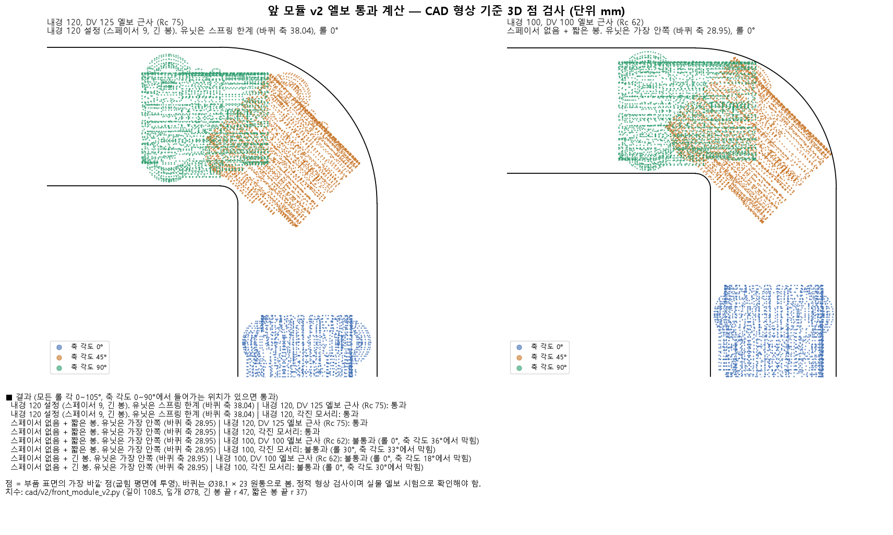
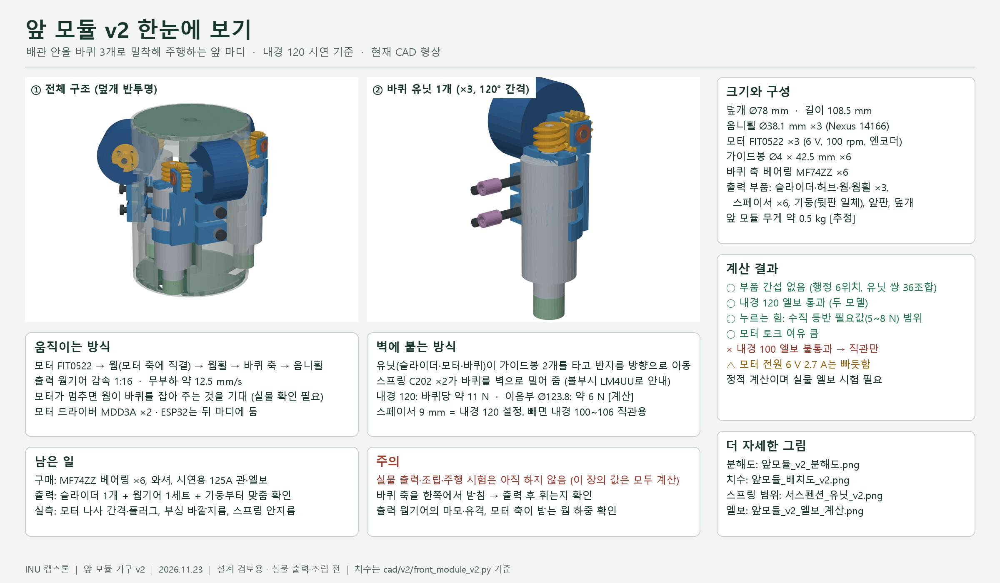
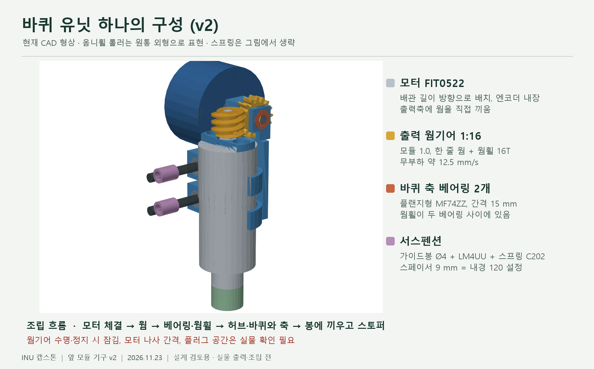
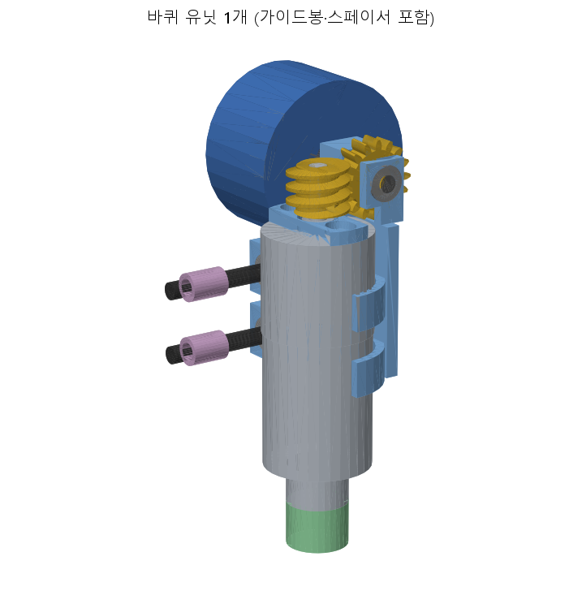
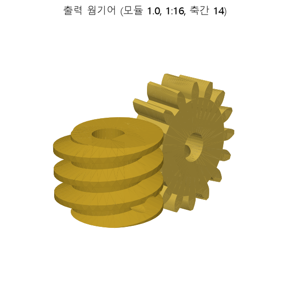
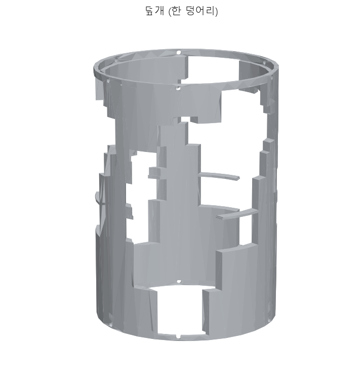

# 앞 모듈 CAD v2 — 내경 120 시연 기준 (내경 100은 직관만 계산상 가능)

- 작성: 2026-11-22. 수정: 2026-11-23
  - 바퀴 축 베어링 하나를 지지판 C로 옮겼다.
  - 덮개를 한 덩어리로 바꿨다.
  - 구매한 부싱 LM4UU(4×8×12) 치수를 반영했다.
  - 웜·웜휠을 출력 부품(모듈 1.0, 1:16)으로 추가했다.
- CadQuery 스크립트 [front_module_v2.py](front_module_v2.py)로 만든 모델이다. **실물 출력·조립은 아직 하지 않았다.**
- 근거:
  - 배치 검토: [2026-11-20-앞모듈_v2_호환_검토.md](../../2026-11-20-앞모듈_v2_호환_검토.md)
  - 부품·구매 현황: [2026-11-23-앞모듈_v2_실현성_부품점검.md](../../2026-11-23-앞모듈_v2_실현성_부품점검.md)
  - 배치도: [2026-11-21-앞모듈_배치도_v2.png](../../figures/2026-11-21-앞모듈_배치도_v2.png)
  - 유닛 그림: [2026-11-21-서스펜션_유닛_v2.png](../../figures/2026-11-21-서스펜션_유닛_v2.png)
  - 그림의 치수와 덮개 모양은 이 스크립트에서 읽는다.
- 대화에서 정한 조건 (2026-11-21~23):
  - 내경 120 시연 기준, C202 + 스페이서 9 mm
  - 웜을 모터 축에 직결하고 스러스트 와셔 사용
  - 덮개 Ø78
  - MDD3A·ESP32는 뒤 마디
  - 웜기어는 시제품 단계에서 출력해서 쓴다
- v1(`../v1/`)은 비교용으로 그대로 둔다.

## 실행

```
python front_module_v2.py              # stl/, step/ 출력 + 간섭 검사 → check_results.txt (약 10분)
python front_module_v2.py --no-check   # 출력만
python preview_v2.py                   # preview/*.png (matplotlib 그림, 확인용)
python ../../figures/앞모듈_v2_설명그림_draw.py   # figures/ 에 설명·발표용 그림 4장 (Pillow 필요)
```

확인 환경: Windows, Python 3.11.9, CadQuery 2.8.0.

## 출력 부품 (`stl/`, `step/`)

| 파일 | 수량 | 크기 (mm) | 설명 |
| --- | --- | --- | --- |
| `slider` | 3 | 45.8 × 24.1 × 53.0 | 바퀴 유닛 몸체. 한 덩어리로 출력:<br>· 지지판 B (바퀴 쪽 베어링), 지지판 C (웜휠 바깥 베어링) — 베어링 간격 15<br>· 모터 고정판 (M3 긴 구멍 16~18, 머리 자리 깊이 1.7)<br>· 모터 위 막대, 모터 위쪽 반원 받침 2개<br>· 귀 2개 (LM4UU 자리: 구멍 Ø8.1, 높이 12, 벽 1.95) |
| `worm` | 3 | Ø14 × 10 | 한 줄 웜, 모듈 1.0, 피치원 Ø12. D자 구멍(Ø4.2, 평면까지 1.6)으로 FIT0522 D축에 끼움. M3 무두 멈춤나사 파일럿 Ø2.5 |
| `wormwheel` | 3 | Ø18 × 5.5 | 16T. 비틀림각 4.76° 헬리컬 기어로 근사한 웜휠. Ø4.1 축 구멍, 이 사이 골에 M3 무두 멈춤나사 파일럿 |
| `hub` | 3 | Ø18 × 8 | 옴니휠 ↔ 바퀴 축. v1과 같은 형상 (M2×4 PCD 12, M3 멈춤나사) |
| `spacer` | 6 | Ø6.5 × 9 | 가이드봉에 끼워 스프링 받침을 9 mm 올림. 내경 100 설정에서는 뺀다 |
| `base` | 1 | Ø74 × 105.5 | 뒷판 + 가운데 기둥(Ø15, 안 Ø8) + 스프링 받침 블록 한 덩어리.<br>· 가이드봉 압입 구멍 6 (Ø3.9, 깊이 4.5)<br>· 모터선 홈 3, 관절 연결 M3 3 (관절 미정)<br>· 덮개 M2 파일럿, 앞판 M2 파일럿 |
| `front_cap` | 1 | Ø74 × 3 | 앞판. 가운데 배선 구멍 Ø8, 기둥 끝에 M2 2개. ToF 자리는 미정 |
| `cover` | 1 | Ø78 × 108.5 | 한 덩어리 덮개, 40.8 cm³. 자세한 내용은 아래 |

`cover` 형상:
- 양 끝은 두께 2 mm로 앞뒤 판 가장자리를 감싼다. 그 사이는 부품이 지나지 않는 곳만 안쪽으로 채워 두께 4 mm(반지름 35~39)다.
- 창 = 움직이는 부품이 지나가는 공간 + 여유 1 mm. 행정 d −12~+3과, 유닛을 바깥에서 끼워 넣는 경로(d +40까지)를 모두 포함한다.
- 앞뒤 판에 M2 12개로 고정한다.

모든 출력 부품은 유효한 단일 솔리드다(스크립트 확인). 끼워맞춤 공차는 구멍에만 0.05~0.1 mm 넣었다. 프린터에 맞춰 조정해야 한다.

## 출력 웜기어

| 항목 | 값 |
| --- | --- |
| 모듈 / 감속 | 1.0 / 1:16 (한 줄 웜, 웜휠 16T) |
| 축간 거리 | 14 mm (= (12 + 16) / 2). 이전 가정과 같아서 슬라이더 배치는 그대로 |
| 이끝 지름 | 웜 Ø14, 웜휠 Ø18 |
| 웜 리드각 | 4.76° |
| 백래시 | 이 두께를 양쪽에서 0.05 mm씩 줄임 (합 0.10 mm) |
| 맞물림 확인 [계산] | 설치 위상에서 실제 이 형상끼리 겹침 0 mm³. 웜휠을 반 피치 돌리면 겹침 21.3 mm³ (이가 제대로 서로 사이에 들어간다는 확인) |
| 속도 [계산] | 무부하 약 12.5 mm/s (FIT0522 100 rpm ÷ 16, 바퀴 Ø38.1) |

- 재료는 PETG나 나일론을 권한다. PLA는 첫 시험용으로만 쓴다. 조립할 때 그리스를 바른다.
- 출력 방향: 웜은 축을 세워서, 웜휠은 눕혀서.
- 웜휠은 정식 웜휠(오목한 이)이 아니다. 헬리컬 기어로 근사해서 이가 웜에 점 접촉한다. 가벼운 하중의 시제품용이다.
- 고정:
  - 웜은 D자 구멍으로 토크를 받고 M3 무두 멈춤나사로 빠짐을 막는다.
  - 웜휠은 M3 무두 멈춤나사로 고정한다. 바퀴 축의 그 자리에 줄로 평면을 조금 내면 미끄러지지 않는다.
- 웜휠(폭 5.5)이 지지판 B와 C 사이(6.5)에 끼어 있어 바퀴 축의 좌우 위치도 잡는다. 따로 축 칼라를 쓰지 않는다.
- 간섭 검사에서는 웜과 웜휠을 이끝 원통(Ø14, Ø18)으로 보았다.
- 마모·유격·정지 시 잠김은 실물로 확인해야 한다. 예비 세트를 더 출력해 둔다.

## 구매품 (유닛 3개 기준)

구매 여부는 팀 구매리스트(2026-11-17 수정본) 기준이다.

| 부품 | 수량 | 구매 | 메모 |
| --- | --- | --- | --- |
| DFRobot FIT0522 | 3 | ✅ | 앞면 M3 간격은 미확인 → 긴 구멍 |
| Nexus 14166 옴니휠 Ø38.1 | 3 | ✅ | |
| 리니어 볼부시 LM4UU (4×8×12) | 6 | ✅ | 귀에 눌러 끼움 |
| 샤프트 Ø4 × 100 | 6 (12개 구매) | ✅ | 잘라서 가이드봉 42.5 × 6, 바퀴 축 약 51 × 3 |
| 스프링 C202 | 6 (20개 구매) | ✅ | 안지름 > 4 인지 확인 |
| MF74ZZ (4×7×2.5, 플랜지 Ø8.2×0.6) | 6 | ❌ | 지지판 B(바퀴 쪽 면)와 C(바깥 면)에 하나씩, 플랜지가 바깥을 향함 |
| M4 평와셔 (얇은 것) | 3 | ❌ | 스러스트 와셔. 웜과 모터 고정판 사이 (틈 1.5) |
| M3 무두 멈춤나사 (길이 3~4) | 9 | 보유 여부 확인 | 허브 3, 웜 3, 웜휠 3 |
| M2 너트 | 12 | 보유 여부 확인 | 허브–바퀴 |
| 나사 M2·M3 | | 보유 | M3 × 5 낮은 머리 ×6 (모터), M2 ×12 (덮개), M2 ×2 (앞판), M2 ×12 (허브–바퀴) |
| 가이드봉 끝 스토퍼 | 6 | 미정 | 두께 2 mm 이하여야 함. 출력한 캡을 접착하거나 Ø4용 푸시너트. 시중 세트칼라(폭 5)는 봉 끝이 반지름 50까지 올라가 내경 100에서 쓸 수 없음 |

## 조립 순서 (제안, 실물 미검증)

덮개가 한 덩어리라서 덮개를 먼저 씌우고 유닛을 창으로 끼운다.

1. **덮개:** `base`에 `cover`를 앞에서 씌우고 뒷판 가장자리에 M2 6개로 고정한다.
2. **가이드봉:** 덮개 창으로 가이드봉 6개를 받침 블록 구멍에 눌러 끼운다. 접착제 병용을 권한다. 각 봉에 스페이서와 C202를 끼운다.
3. **유닛 조립:** 덮개 밖에서 유닛마다 아래 순서로 조립한다.
   1. 귀 2곳에 LM4UU를 눌러 끼운다.
   2. 모터를 슬라이더 반원 받침 아래쪽에서 넣고, 앞에서 M3 2개로 고정판에 조인다.
   3. 와셔와 웜을 모터 축에 끼우고 멈춤나사로 고정한다.
   4. 지지판 B·C에 MF74ZZ를 하나씩 끼운다.
   5. 웜휠을 B와 C 사이에 위에서 넣는다.
   6. 허브와 바퀴를 M2 4개로 미리 결합한다.
   7. 바퀴 축을 허브·바퀴 → 베어링 B → 웜휠 → 베어링 C 순서로 꽂고, 웜휠 멈춤나사를 조인다.
   - 모터 나사는 웜보다 먼저 조여야 한다. 나사 머리와 웜이 앞에서 보면 겹친다.
4. **유닛 장착:**
   1. 조립한 유닛을 자기 창 쪽 바깥에서 반지름 방향으로 밀어 넣는다. LM4UU가 봉에 끼워진다.
   2. 스프링을 누르며 봉 끝(반지름 45~47)에 스토퍼를 단다.
   3. 모터선은 뒷판 홈으로 뺀다.
5. **앞판:** `front_cap`을 기둥 끝에 M2 2개로 고정하고, 덮개 앞 가장자리를 M2 6개로 고정한다.

## 검사 결과 (`check_results.txt`)

- 검사 위치: 바퀴 축 변위 d = −12(내경 100 −2), −10(내경 100 접촉), −2.91(스프링 한계), 0(내경 120), +1.9(이음부 Ø123.8), +3(스토퍼).
- 스페이서는 d ≥ −2.91에서만 넣었다. 그보다 안쪽은 스페이서를 뺀 내경 100 설정이다.
- 결과 (겹침 0.01 mm³ 초과를 보고):
  - 유닛 내부 부품끼리 겹침 없음. 축–바퀴·웜–웜휠처럼 맞물리거나 끼워지는 쌍은 뺐다.
  - 유닛 0 ↔ 고정부(base·앞판·덮개·가이드봉·스페이서): 6위치 모두 겹침 없음.
  - 유닛 0 ↔ 유닛 1: 위치 6 × 6 = 36조합 모두 겹침 없음. 회전 대칭이라 나머지 쌍을 대표한다.
- 한계:
  - 스프링·나사·배선·공구는 형상에 없다.
  - 이산 위치 검사다.
  - 유닛을 끼워 넣는 경로는 덮개 창 계산에만 넣었고, 따로 충돌 검사하지 않았다.

## 엘보 통과 계산 (`elbow_results.txt`)

실행: `python ../../figures/앞모듈_v2_검토.py` (10분 이상 걸림). 이 CAD의 실제 부품 표면 점을 3D로 검사한다. 방법과 한계는 [v2 검토 문서 3절](../../2026-11-20-앞모듈_v2_호환_검토.md)에 있다.

| 설정 | 내경 120 엘보 (DV 125 근사 / 각진 모서리) | 내경 100 엘보 (DV 100 근사 / 각진 모서리) |
| --- | --- | --- |
| 내경 120 설정 (스페이서 9, 긴 봉), 유닛은 스프링 한계 | 통과 / 통과 | 해당 없음 (이 설정은 내경 100에 쓰지 않음) |
| 스페이서 없음 + 짧은 봉 (끝 37), 유닛은 가장 안쪽 | 통과 / 통과 | **불통과 / 불통과** |
| 스페이서 없음 + 긴 봉 (끝 47), 유닛은 가장 안쪽 | — | **불통과 / 불통과** |

- 내경 120 시연 조건은 성립한다.
- **내경 100 엘보는 지금 형상으로는 통과하지 못한다.** 내경 100 직관에는 들어간다 (가장 바깥 점 반지름 49.4).
  - 2026-11-23 이전 문서의 "내경 100 엘보 통과"는 2D 단순 외곽 계산 결과였다. 그 외곽이 슬라이더의 모터 위 막대와 지지판 C 모서리를 빠뜨렸다.
  - 위 표는 바퀴를 Ø38.1 × 23 원통으로 본 결과다. 바퀴 가장자리를 반지름 5로 둥글려 계산하면 DV 100 근사 모델은 통과하고 각진 모서리는 불통과다 (`--round-wheel` 진단). 여유가 거의 없는 경계선이다.
  - 내경 100에서 엘보까지 확실히 쓰려면 슬라이더 바깥 모서리를 줄이는 재설계가 필요하다.
- 정적 형상 검사다. 실물 엘보 시험이 필요하다.



## 바퀴 축 베어링 하중 [계산, 정적]

바퀴 하중 11.3 N(내경 120 설치 시 스프링 힘)만 고려했다.

| 배치 | 베어링 간격 | 가까운 베어링 | 먼 베어링 |
| --- | --- | --- | --- |
| 2026-11-22안 (지지판 B에 2개) | 6 | 38.1 N | 26.8 N |
| 지금 (B와 C에 하나씩) | 15 | 22.0 N | 10.7 N |

- 웜휠이 두 베어링 사이에 들어가서 웜 맞물림 위치도 더 안정된다.
- 바퀴 자체는 여전히 허브 쪽이 비어 있다. 바퀴 중심에서 가까운 베어링까지 약 14 mm다.

## 배치 검토(2026-11-20)와 달라진 점

| 항목 | 검토안 | CAD v2 | 이유 |
| --- | --- | --- | --- |
| 바퀴 축 지지 | 지지판 A(허브 쪽)·B | 지지판 B(바퀴 쪽)·C(웜휠 바깥) | A를 슬라이더에 이으려면 바퀴 뒤로 돌아야 하는데, 옆 유닛 모터·덮개와 겹침 |
| 슬라이더 연결 | 정하지 않음 | 지지판 B·C → 모터 위 막대 → 반원 받침 → 귀 | 바퀴 아래와 가운데를 비워 내경 100에서 세 유닛이 닿지 않게 함 |
| 앞판 | z 19~22, Ø70 | z 20~23, Ø74 | 바퀴 앞끝(19.05)과 겹쳐서 1 mm 앞으로. 덮개를 걸치려고 판을 키움 |
| 모듈 길이 | 107.5 | 108.5 | 위와 같음 |
| 덮개 | 두께 2, 창 각도를 손으로 정함 | 한 덩어리, 두께 2~4, 창은 부품이 지나는 공간으로 자동 계산 | 실제 형상 기준 |
| 부싱·가이드봉 | Ø7 × 8 가정, 봉 끝 반지름 43, 가이드 z −25·−40 | LM4UU Ø8 × 12, 봉 끝 반지름 47, 가이드 z −26·−41 | 구매품 치수. 귀가 넓어져 바퀴와 닿지 않게 1 mm 뒤로 |
| 웜기어 | 모듈 0.8, 20T 구매품 가정 | 모듈 1.0, 16T 출력 | 국내에서 맞는 제품을 못 찾음. 모듈 0.8은 출력하기에 이가 너무 작음 |

## 남은 문제

- **허브 쪽 지지판이 없다.** 지지판 C로 베어링 간격을 넓혀 대신했다. 출력 후 휘는지 확인해야 한다.
- **출력 웜기어:** 수명과 정지 시 잠김은 실물로 확인해야 한다.
- **가이드봉 끝 스토퍼:** 두께 2 mm 이하로 고정할 방법을 정해야 한다.
- **웜 직결:** 모터 출력축 베어링이 축 방향 하중을 얼마나 견디는지는 미확인이다. 막힘을 감지해 전류를 제한하는 기능이 필요하다.
- **아직 정하지 않은 것:** 관절 연결 형상, ToF 자리.
- **실측이 필요한 것:** FIT0522 플러그 공간(10 mm로 가정)과 방향·나사 간격, LM4UU 실제 바깥지름, C202 안지름.

## 그림

설명·발표용 (`../../figures/`, 스크립트 `앞모듈_v2_설명그림_draw.py`):






확인용 (`preview/`):





