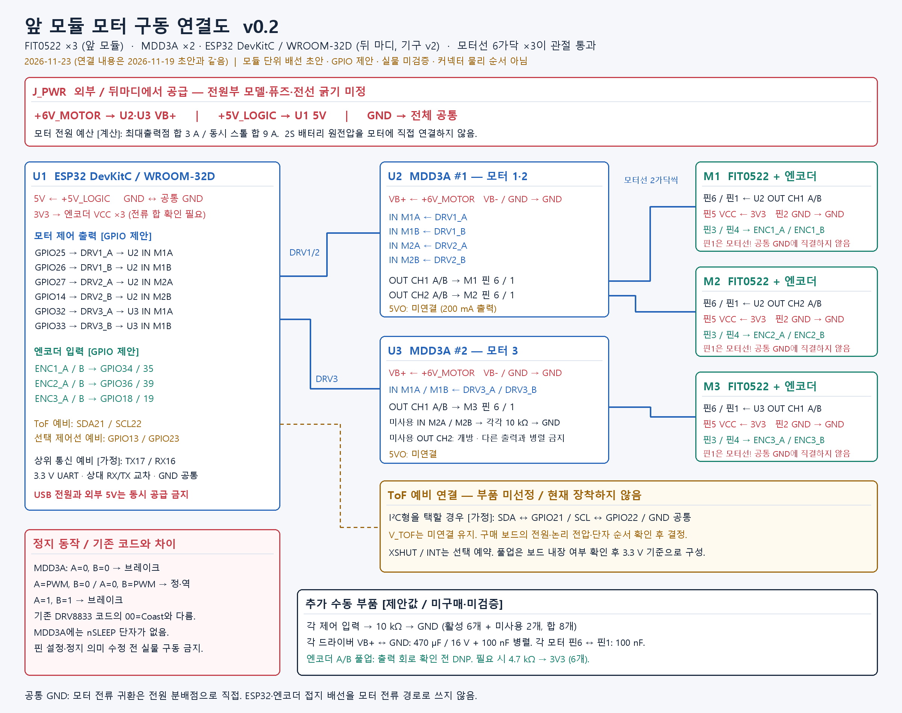

# 앞마디 회로·배선 초안 v0.1

> 2026-11-23: 기구가 [CAD v2](../cad/v2/README.md)로 바뀌었다. v2에서는 MDD3A 2개와 ESP32를 앞마디가 아닌 뒤 마디에 둔다 (2026-11-22 대화에서 정함). 아래 연결표(net, GPIO, 6핀 연결)는 그대로 참고할 수 있다. 다만 "앞마디에 드라이버를 둔다"는 배치 전제와 기구 CAD 관련 문장은 v1 기준이다. 모터선 6가닥 × 3이 관절을 지나게 된다. 연결도 그림의 제목 줄만 v0.2로 바꿔 다시 그렸고, 연결 내용은 2026-11-19 초안과 같다.

작성: 2026-11-19. 앞마디만 검토한다. **실물 미검증인 모듈 간 연결도이며 PCB 제작용 상세 회로도가 아니다.** 부품 사양과 제안한 GPIO를 구분한다. 전원 회로, 실물 커넥터 방향, 배선 굵기 및 보호 부품 정격은 확정하지 않았다.

- [확대용 SVG](front_module_wiring.svg), [PDF](front_module_wiring.pdf)
- 재생성: `python draw_front_wiring.py` (Pillow 및 Windows 맑은 고딕 필요).
- 그림의 블록은 기판 내부 회로가 아닌 **외부 모듈**이다. 같은 net 이름은 전기적으로 연결한다. 선 여러 가닥을 묶어 그린 부분은 아래 연결표를 따른다. 그림의 텍스트 배치는 실제 커넥터 단자 순서가 아니다.

## 이번 초안의 구성

| 항목 | 상태 |
| --- | --- |
| FIT0522 ×3 | 재고 사유로 FIT0521에서 변경했다고 사용자 확인. 견적서에도 FIT0522 ×3 기재 |
| MDD3A ×2 | 구매품 사용 유지. 앞마디에서 3채널을 쓰고 1채널은 비워 두는 이번 초안의 배치 가정 |
| ESP32 DevKitC WROOM-32D V4 | 인계 문서의 모델 기준. 호환 보드 실물 핀맵·전원 회로는 재확인 필요 |
| ToF | 미선정. I²C형을 고르는 경우를 가정해 신호만 예약. 전원·커넥터 미확정 |
| 외부 6 V 모터 전원 / 5 V 로직 전원 | 앞마디 입력 인터페이스 제안. 레귤레이터·퓨즈·스위치·커넥터 모델 미정 |
| 관절 너머 통신 | 3.3 V UART 예약만 함. 실제 통신 방식·노이즈 대책은 미확정 |

기구 CAD와 조립 키트는 FIT0522와 앞 MDD3A 한 개를 반영한다. 기구 B안은 앞 드라이버가 두 모터를, 뒤 마디 드라이버가 나머지 앞 모터를 구동한다. 아래 연결도는 두 드라이버를 모두 앞에 놓는 초안이다. 배치와 관절을 지나는 배선은 팀 결정 전이다. [앞마디 기구 설계](../cad/README.md)

## 1. 전원 연결

| net | 연결 |
| --- | --- |
| `+6V_MOTOR` | 외부에서 조정된 6 V → U2/U3의 `VB+` |
| `GND` | U2/U3 `VB−`, 신호 GND, ESP32 GND, 세 엔코더 핀2 및 센서용 GND 공통 |
| `+5V_LOGIC` | 외부 조정된 5 V → ESP32 `5V` 핀. 모터 전원과 구분 |
| `3V3` | ESP32의 `3V3` → 세 엔코더 핀5. 실제 소비 전류 합과 보드 LDO 여유는 확인 필요 |
| U2/U3 `5VO` | **둘 다 미연결**. 서로 또는 외부 5 V 레일과 묶지 않음 |
| `V_TOF` | **미연결 유지**. 센서 구매 후 입력 전압·레벨 변환·소비 전류에 맞춰 정함 |

- [사양] MDD3A `5VO`는 최대 200 mA인 **출력**이다. 이 초안은 ESP32를 여기서 공급하지 않는다.
- [사양] DevKitC의 USB / 외부 5 V / 외부 3.3 V 전원 입력은 한 방식만 사용한다. 외부 5 V를 넣은 채 일반 USB 전원을 중복 연결하지 않는다. USB 디버깅은 전원 구성을 분리한 후 수행한다. 호환 보드도 회로 확인이 필요하다.
- [계산] FIT0522 세 개의 최대출력점 전류 합은 `1 A ×3 = 3 A`, 동시 스톨 전류 합은 `3 A ×3 = 9 A` (6 V 기준)이다. 이는 전원 선정의 부하 조건이며 평균 소비 전류·퓨즈 정격을 뜻하지 않는다. 3 A 동작점에서도 기동 여유는 별도로 필요하다.
- 인계 문서의 D36V28F6 전원만으로 세 모터의 동시 기동·막힘을 감당한다고 가정하지 않는다. 전원 용량 또는 동시 구동·전류 제한 정책을 정해야 한다.
- 퓨즈·차단 스위치는 모터 전원 경로에 고려하되 값은 미정. 2S LiPo 원전압을 6 V 모터에 직접 연결하는 회로가 아니다. 모터 차단과 별개로 로직 전원을 유지할 수 있게 분리한다.
- 모터 전류 귀환은 전원 분배점으로 보내고, ESP32·엔코더 접지선에 모터 전류가 흐르는 직렬 배선을 피한다.

## 2. 모터 제어 핀 — 전부 제안값

현재 펌웨어에 반영하지 않았다. 표의 GPIO는 **칩의 GPIO 번호**이며 헤더의 물리적 몇 번째 핀을 뜻하지 않는다. ESP32-WROOM 기준으로 플래시·부트 스트랩·USB UART0 핀을 피해서 배정했다.

| 코드 모터 번호 | 모터 | ESP32 → 입력 A | ESP32 → 입력 B | 드라이버 출력 |
| --- | --- | --- | --- | --- |
| 0 | M1 | GPIO25 → U2 IN M1A (`DRV1_A`) | GPIO26 → U2 IN M1B (`DRV1_B`) | U2 OUT CH1 A/B |
| 1 | M2 | GPIO27 → U2 IN M2A (`DRV2_A`) | GPIO14 → U2 IN M2B (`DRV2_B`) | U2 OUT CH2 A/B |
| 2 | M3 | GPIO32 → U3 IN M1A (`DRV3_A`) | GPIO33 → U3 IN M1B (`DRV3_B`) | U3 OUT CH1 A/B |
| — | 미사용 | U3 IN M2A → 10 kΩ → GND | U3 IN M2B → 10 kΩ → GND | U3 OUT CH2 A/B는 개방 |

- [사양] 3.3 V 논리로 MDD3A를 제어할 수 있다. 제어 헤더의 M1A/M1B/M2A/M2B와 모터 출력 단자를 혼동하지 않는다.
- [제안] 활성 제어 입력 6개에도 각각 10 kΩ 풀다운을 추가한다. 미사용 포함 총 8개. 부팅 중 입력 부유를 줄이려는 제안이며 실물 확인 전이다.
- [제안] 초기 PWM 주파수 10 kHz. MDD3A 사양 상한 20 kHz 이하. 주파수·해상도·출력 제한은 펌웨어와 실물 검증 후 확정한다.
- 두 드라이버 출력 또는 채널 출력을 서로 병렬 연결하지 않는다.

### 기존 코드와 충돌: 정지 의미

제조사 데이터시트 Rev 1.0의 MDD3A 동작표:

| 입력 A | 입력 B | 동작 |
| --- | --- | --- |
| LOW | LOW | 브레이크 |
| PWM | LOW | 한 방향 구동 / PWM OFF 구간 브레이크 |
| LOW | PWM | 반대 방향 구동 / PWM OFF 구간 브레이크 |
| HIGH | HIGH | 브레이크 |

`drive/ESP_Code/README.md`와 `include/motor.h`는 DRV8833 기반이며 00을 Coast로 설명한다. **그 설명을 MDD3A에 적용하면 안 된다.** MDD3A에는 현재 코드가 가정하는 nSLEEP도 없다. 두 입력만으로 코스트를 선택할 수 있다고 전제하지 않는다.

현재 `board_config.h`는 핀 미정·하드웨어 비활성이다. 향후 모터 수 3, 표의 GPIO, 드라이버별 정지 의미, 외부 활성화 확인 설정 등을 검토해야 한다. `externalSleepConfirmed=true`만 바꿔서 코스트 기능이 생기는 것은 아니다. 부팅·타임아웃·반전 대기의 실제 동작도 다시 확인해야 한다. 이번 작업은 코드 수정·업로드·모터 구동을 포함하지 않는다.

## 3. FIT0522 6핀 연결 — 세 모터에 동일하게 적용

번호는 제조사 기준이다. 실물 래치 방향·핀1 표시를 확인해야 하며 선 색상은 가정하지 않는다.

| 모터 커넥터 핀 | 기능 | 이 초안의 연결 |
| --- | --- | --- |
| 1 | 모터 구동선 한쪽 | 해당 채널 OUT B. **공통 GND 직결 금지** |
| 2 | 엔코더 GND | 공통 GND |
| 3 | 엔코더 A | 해당 `ENCn_A` |
| 4 | 엔코더 B | 해당 `ENCn_B` |
| 5 | 엔코더 VCC | 3V3 |
| 6 | 모터 구동선 반대쪽 | 해당 채널 OUT A |

제조사 표에서 핀1을 모터 GND라고 부르지만, H브리지 정·역회전 구동에서는 OUT B에 연결한다. OUT A/B를 바꾸면 회전 방향이 바뀌므로 실제 전진 방향과 엔코더 부호를 확인한다.

| 신호 | M1 → ESP32 | M2 → ESP32 | M3 → ESP32 |
| --- | --- | --- | --- |
| 엔코더 A / 핀3 | GPIO34 | GPIO36 (VP) | GPIO18 |
| 엔코더 B / 핀4 | GPIO35 | GPIO39 (VN) | GPIO19 |

- [사양] 엔코더는 3.3 V 또는 5 V 전원을 지원한다. 이번 초안은 ESP32와 맞춰 3.3 V로 공급한다. 실물 출력 레벨과 파형은 확인 전이다.
- GPIO34/35/36/39는 입력 전용이며 내부 풀업을 기대하지 않는다. 엔코더 출력 회로가 오픈 컬렉터인지 푸시풀인지 미확인이다. A/B 각각 4.7 kΩ → 3V3 풀업 자리는 **DNP(미장착)**로 예약하고, 출력 회로·보드 내장 저항을 확인한 뒤 장착 여부를 정한다.
- [사양] FIT0522 출력축 분해능 표기는 823.1 PPR. 코드가 x4 계수하므로 이 숫자를 그대로 `countsPerOutputRev`에 넣지 않는다. 제조사 계수 정의와 축 1회전 실측을 확인한다.

## 4. ToF — 구매 전 고려만

I²C형 ToF **한 개**를 가정한 예약이다. UART형·다중 센서 등 다른 제품을 고르면 다시 배정한다.

| 기능 | ESP32 예약 [제안] | 현재 상태 |
| --- | --- | --- |
| SDA | GPIO21 | 센서 장착 전 미연결 |
| SCL | GPIO22 | 동일 |
| XSHUT 또는 선택 제어선 | GPIO13 | 제품이 지원할 때만 사용 |
| INT 또는 선택 입력 | GPIO23 | 동일 |
| 센서 전원 | V_TOF | 3.3 V/5 V 여부 미정. 6 V 레일과 연결하지 않음 |
| GND | 공통 GND | 센서 커넥터 물리 순서는 제품 선정 후 결정 |

ESP32측 I²C 풀업 전압은 3.3 V 기준이다. 실제 센서 칩 논리 전압이 더 낮으면 레벨 변환이 필요할 수 있다. 센서 보드 내장 레귤레이터·풀업·레벨 변환 여부를 확인하고, 같은 저항을 중복 장착하지 않도록 한다. 커넥터 종류·핀 수·순서는 이번 초안에서 확정하지 않는다.

## 5. 추가 부품 제안 — 구매 확정 아님

| 부품 | 제안 수량·값 | 연결 |
| --- | --- | --- |
| 제어 입력 풀다운 | 8 × 10 kΩ | U2/U3 제어 입력 → GND |
| 드라이버 전원 벌크 콘덴서 | 2 × 470 µF, 16 V | 각 VB+와 GND 사이. 극성 확인 |
| 고주파 전원 바이패스 | 2 × 100 nF | 각 드라이버 전원 가까이, 벌크와 병렬 |
| 모터 단자 잡음 억제 | 3 × 100 nF, 정격 여유품 | 각 모터 핀6과 핀1 사이, 모터 가까이 |
| 엔코더 풀업 자리 | 6 × 4.7 kΩ, DNP | 각 A/B → 3V3, 출력 회로 확인 후 결정 |

위 값은 초기 설계 제안이다. 커패시터의 허용오차·리플·전압 정격, 인러시·전압 강하·PWM 잡음·회생 에너지 처리 등을 실제 전원과 함께 검토해야 한다. 부품 정격·배선·퓨즈는 이 표만으로 확정하지 않는다.

## 검증 상태와 다음 단계

자료와 기존 코드를 대조했고 SVG/PNG/PDF를 생성해 배치를 확인했다. 전기 시뮬레이션, ERC, PCB 배선, 보드 실측, ESP32 빌드·업로드 및 실물 모터 시험은 하지 않았다.

다음 단계는 전원 용량과 실물 핀 방향 확인, MDD3A용 펌웨어 정지 의미 정리, 그리고 모터 1개에서 낮은 출력으로 방향·엔코더를 확인하는 시험 계획 수립이다. 실제 구동은 별도 확인한 시험 범위에서만 수행한다.

## 근거

- [DFRobot FIT0522 제조사 사양·핀맵](https://wiki.dfrobot.com/fit0522/)
- [Cytron MDD3A 제품 사양](https://www.cytron.io/p-3amp-4v-16v-dc-motor-driver-2-channels)
- [제품 페이지에 연결된 MDD3A 데이터시트 Rev 1.0](https://docs.google.com/document/d/1ax3gSo0srTzoSr2bo8ETLym0OqrYjlk_JCZK4kxtfXg/edit?usp=sharing) — 입력 진리표·단자명·5VO 출력 한도 확인
- [Espressif ESP32-DevKitC V4 핀·전원 안내](https://docs.espressif.com/projects/esp-dev-kits/en/latest/esp32/esp32-devkitc/user_guide.html)
- 저장소 `drive/ESP_Code/README.md`, `include/board_config.h`, `include/motor.h` — 기존 구현 상태 확인
- 사용자 제공 2026-11-15 견적서 및 이 대화의 FIT0522 변경 확인 — 구매품 기준
