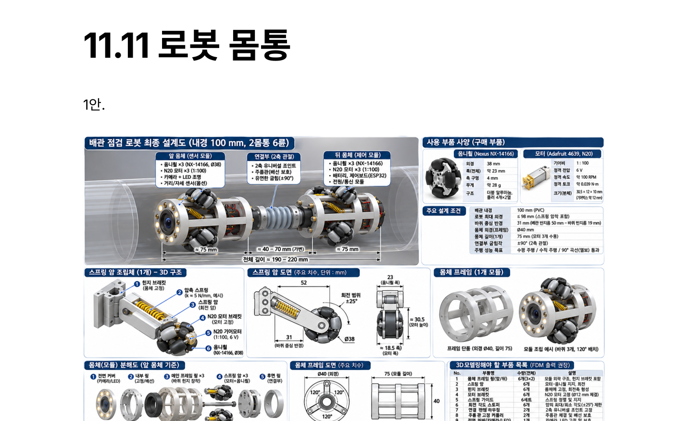
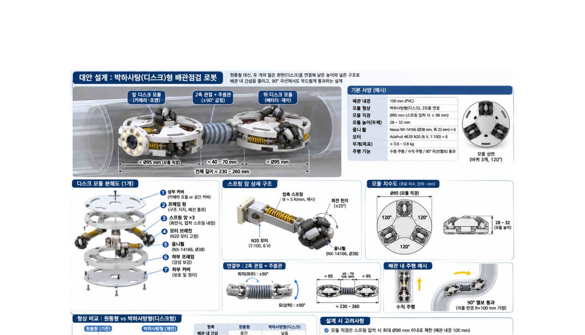
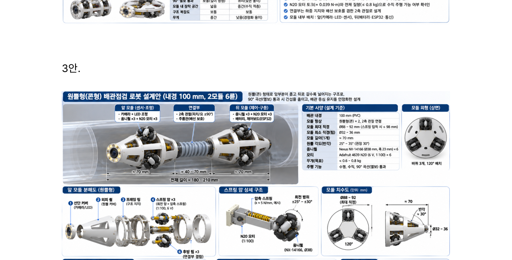
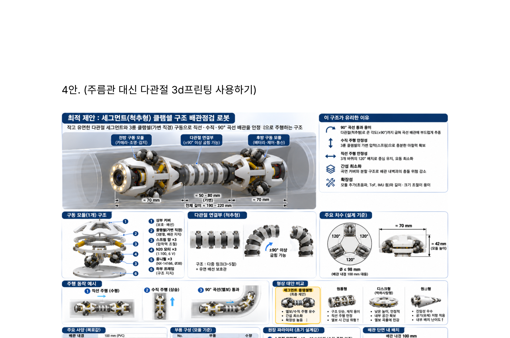
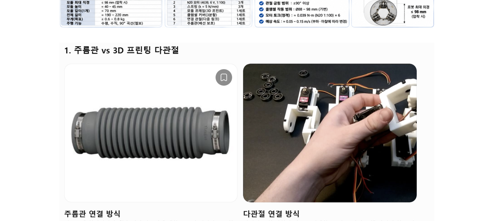
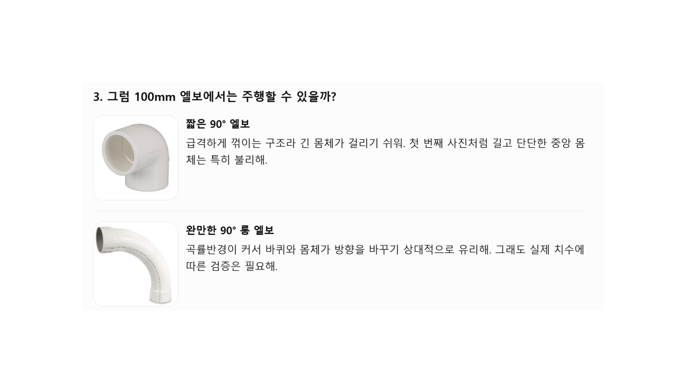

# 로봇 몸통 설계안 비교 및 검토

> **조사 자료:** 「11.11 로봇 몸통」 (2026.11.11)  
> **목적:** 내경 100 mm 배관용 검사 로봇의 몸통 형상, 전·후방 연결부, 바퀴 배치 및 90° 엘보 통과 가능성을 비교·검토한다.  
> **상태:** 설계 후보 검토 자료. 아래 치수와 성능은 원본 제안에 기재된 값이며, 제작·실험으로 검증된 결과가 아니다.

## 1. 설계 조건 및 공통 개념

- **배관 조건:** 내경 100 mm PVC 배관을 기준으로 검토
- **구성:** 전방·후방 두 몸통을 연결부로 이어 굴곡 구간에 대응하는 구조
- **바퀴:** 각 몸통에 3개를 약 120° 간격으로 배치하는 설계안 검토
- **검토 기능:** 직선 주행, 수직 주행 가능성, 90° 엘보 통과, 몸통 간 간섭 및 연결부 굽힘
- **주의:** 짧고 급격한 90° 엘보 통과는 이미지상의 형상만으로 보장되지 않으며, 실제 엘보 내측 반경과 몸통 치수로 확인해야 함

## 2. 몸통 설계 후보

### 2.1. 1안 — 원통형 프레임, 2몸통·6륜

- 전·후방 원통형 프레임에 각각 3개의 바퀴를 배치한 기본 구조
- 바퀴 지지부에 스프링을 적용하여 배관 내벽과의 접촉을 유지하도록 구상
- 두 몸통 사이에 주름관 형태의 유연한 연결부를 배치
- **검토 포인트:** 구조가 비교적 단순하지만, 급격한 엘보에서 몸통 길이와 연결부 굽힘에 따른 간섭을 확인해야 함

### 2.2. 2안 — 방사상 디스크형 프레임

- 원통형 대신 얇은 원판·디스크형 프레임으로 몸통을 구성하는 대안
- 각 디스크 주변에 바퀴와 스프링 암을 배치
- 두 몸통을 유연한 연결부로 연결
- **검토 포인트:** 축방향 길이를 줄이는 방향으로 검토할 수 있으나, 부품 배치 공간과 바퀴 지지 구조를 확인해야 함

### 2.3. 3안 — 원뿔형 프레임

- 전·후방 몸통을 원뿔형으로 설계한 대안
- 선단이 좁아지는 형상으로 엘보 진입 시 간섭을 줄이는 방향을 검토
- 3륜 배치와 스프링 암, 유연 연결부를 함께 고려
- **검토 포인트:** 좁은 선단의 진입성뿐 아니라 후방 프레임·바퀴가 엘보 안쪽에 걸리는지 확인 필요

### 2.4. 4안 — 세그먼트(척추형) 다관절 연결

- 전·후방 몸통 사이의 **주름관을 다관절 3D 프린팅 링크로 대체**하는 구상
- 짧은 관절 여러 개가 순차적으로 꺾이면서 굴곡 구간에 대응하도록 설계
- 원본 자료에서 수직 주행과 90° 엘보 통과를 고려한 대안으로 제시
- **검토 포인트:** 관절별 가동각, 총 연결 길이, 회전 자유도, 배선 통로 및 관절 강도 확인 필요

## 3. 연결부 방식 비교

| 구분 | 주름관 연결 | 3D 프린팅 다관절 연결 |
| --- | --- | --- |
| 기본 구조 | 유연한 주름관으로 두 몸통 연결 | 여러 개의 짧은 링크와 관절로 연결 |
| 장점·가능성 | 구조가 비교적 단순하고 유연함 | 관절 수와 굽힘 각도를 설계·조절하기 용이 |
| 우려 사항 | 압축·인장·비틀림 시 구조적 지지가 부족할 수 있음 | 관절 유격, 마찰, 내구성 및 조립 복잡도 검토 필요 |
| 확인할 사항 | 굽힘 반경, 복원력, 배선 보호 | 관절 수, 가동 범위, 간섭, 배선 경로 |

> 원본 페이지 3에는 두 연결 방식의 참고 이미지와 간단한 장단점이 포함되어 있다. 위 표는 이를 GitHub에서 비교하기 쉽게 정리한 것이다.

## 4. 100 mm 배관의 90° 엘보 통과 검토

### 4.1. 짧은 90° 엘보

- 급격하게 꺾이는 구조이므로 긴 몸통이 걸리기 쉬움
- 특히 첫 번째 차체처럼 길고 단단한 중앙 몸체에는 불리할 수 있음

### 4.2. 완만한 90° 롱 엘보

- 곡률반경이 커서 바퀴와 몸체가 방향을 바꾸기 상대적으로 유리함
- 다만 실제 치수에 따른 검증은 여전히 필요함

### 4.3. 검증 항목

- [ ] 실제 사용할 PVC 배관과 엘보의 내경·곡률반경 측정
- [ ] 각 몸통의 최대 외경 및 축방향 길이 확정
- [ ] 바퀴와 스프링 암의 배관 벽 간섭 확인
- [ ] 연결부 최대 굽힘각 및 관절 간 충돌 확인
- [ ] 직선 → 짧은 90° 엘보 → 직선 통과 시험
- [ ] 수직 배관에서 바퀴 접지력과 미끄러짐 시험
- [ ] 전진뿐 아니라 후진·복귀 동작 확인

## 5. 설계안 요약

| 설계안 | 핵심 형상 | 주요 검토 과제 |
| --- | --- | --- |
| 1안 | 원통형 2몸통·6륜 | 몸통 길이 및 주름관 굽힘 |
| 2안 | 방사상 디스크형 | 프레임 내 부품 배치 및 강성 |
| 3안 | 원뿔형 | 선단 진입성과 후방 간섭 |
| 4안 | 세그먼트형 다관절 연결 | 관절 수·가동각·내구성 |

**정리:** 원본 자료는 네 가지 몸통 설계안을 제시하고, 특히 **주름관과 다관절 3D 프린팅 연결부의 비교**, **짧은 90° 엘보와 롱 엘보의 통과 난이도 차이**를 강조한다. 특정 안의 주행 성공 여부는 아직 실험으로 확인되지 않았다.

---

### 이미지 및 출처

- 이미지 출처: 사용자가 제공한 「11.11 로봇 몸통」 PDF의 해당 페이지를 GitHub 열람용으로 추출
- `images/` 폴더의 PNG 6개를 이 Markdown 파일과 **같은 상위 폴더 구조**로 업로드해야 이미지가 표시됨
