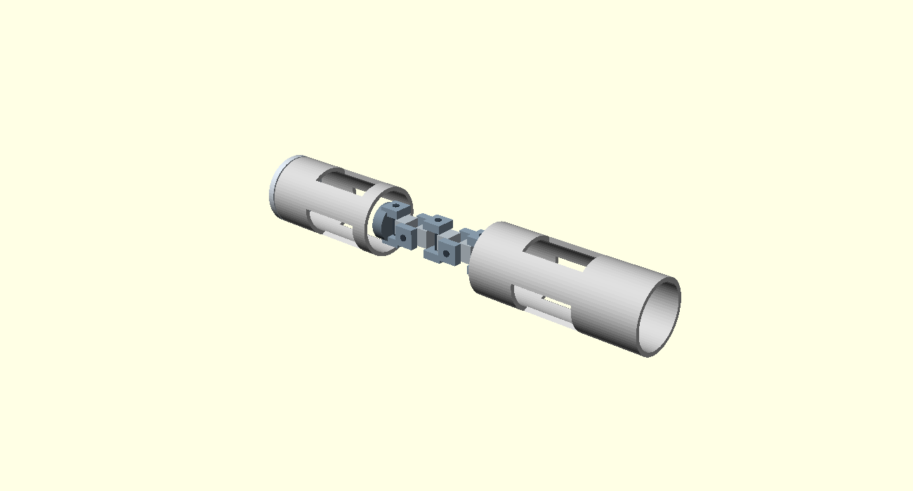

# 원통형 배관 검사 로봇 — 몸체 외피 설계 (Wheel-module slots)

> **상태:** 1차 형상 설계 / 조립 및 주행 검증 전



## 1. 설계 목적

내경 **100 mm PVC 배관**을 주행하는 검사 로봇의 앞·뒤 몸체를 **원통형 외피**로 제작한다. 앞뒤 몸체를 중앙 다관절로 연결하고, 각 원통 외피에 바퀴 압착 모듈을 별도로 장착할 수 있도록 **120° 간격의 개구부 3개씩(총 6개)**를 둔다.

목표 주행 환경은 수평·수직 배관과 **급격한 90° 숏 엘보**이다. 다만 **해당 환경에서의 통과 및 등판 성능은 아직 검증되지 않았다.**

## 2. 모듈별 구성 계획

| 구분 | 배치 계획 | 현재 CAD 반영 범위 |
| --- | --- | --- |
| 앞 몸체 | 옴니휠 3개, 카메라, LED, 초음파 탐촉자 장착부 | 원통 외피, 바퀴용 개구부 3개, 별도 카메라/LED 전면판 |
| 중앙 연결부 | 3D 프린팅 다관절, Ø4 샤프트, 배선 보호 | **형상 확인용 4링크·5핀 개념 모델만** |
| 뒤 몸체 | 바퀴 3개, 구동 모터 3개, ESP32, 모터드라이버, 배터리, 측면 ToF | 원통 외피, 바퀴용 개구부 3개 |
| 바퀴 압착 모듈 | Ø4 가이드봉, LM4UU 리니어 부싱, 압축 스프링, 별도 바퀴 브래킷 | **미포함 — 별도 설계/출력 예정** |

> 주의: 앞쪽 수동 옴니휠과 뒤쪽 구동 바퀴의 실제 체결 가능 여부는 구매 부품의 축/허브 규격 확인이 필요하다. 카메라·LED·ToF·탐촉자·전자부품의 장착홀과 내부 고정구는 아직 모델링하지 않았다.

## 3. 현재 CAD 치수

| 항목 | 값 | 비고 |
| --- | --- | --- |
| 앞 몸체 외경 × 길이 | Ø42 × 75 mm | 임시값 |
| 뒤 몸체 외경 × 길이 | Ø42 × 105 mm | 임시값 |
| 외피 두께 | 2.5 mm | 임시값 |
| 바퀴 모듈 개구부 | 축방향 38 × 접선방향 24 mm | 실제 부품 간섭 미검증 |
| 개구부 위치 | 각 몸체 120° 간격 × 3 | 총 6개 |
| 카메라 전면판 | Ø42 mm, 중앙 Ø12 mm 구멍 | 카메라 실물 규격 미확정 |
| LED 구멍 | Ø3.2 mm × 6 | LED 실물 규격 미확정 |
| 중앙 다관절 | 4링크·5핀 개념 | 출력용 STL 미제공 |

**참고:** 전체 길이, 바퀴 포함 외경, 엘보 통과 가능 여부는 이 외피 모델만으로 확정할 수 없다.

## 4. 파일 구조

```text
mechanical/cylindrical-body/
├── README.md
├── cad/
│   └── robot_shell_slots.scad    # 수정 가능한 OpenSCAD 원본
├── stl/
│   ├── front_shell.stl          # 앞 원통 외피
│   ├── rear_shell.stl           # 뒤 원통 외피
│   └── camera_plate.stl         # 카메라·LED 전면판
└── images/
    └── assembly_preview.png    # 조립 개념 미리보기
```

## 5. 모델 열기 및 STL 내보내기

1. [OpenSCAD](https://openscad.org/)에서 `cad/robot_shell_slots.scad`를 연다.
2. 코드 상단 `part="assembly";`를 원하는 항목으로 변경한다.
   - `front`: 앞 원통 외피
   - `rear`: 뒤 원통 외피
   - `camera_plate`: 카메라 전면판
   - `joint`: 중앙 다관절 개념 형상 (**제작용 아님**)
   - `assembly`: 전체 조립 개념도
3. `F5`로 미리보기, `F6`으로 렌더링한다.
4. `File → Export → Export as STL`에서 STL을 저장한다.

`stl/` 폴더에는 앞·뒤 외피와 전면판 STL이 이미 포함되어 있다.

## 6. 원통형 몸체의 장단점 및 형상 선정 근거

### 6.1 원통형 구조를 선택한 배경

본 로봇은 **내경 100 mm PVC 배관** 내부에서 주행하고, 앞·뒤 두 몸체를 **중앙 다관절**로 연결하는 구조를 목표로 한다. 초기에는 원형 링과 지지대로 구성된 **개방형 프레임**도 검토했으나, 카메라·조명·전자부품 보호와 외형의 일체성을 고려해 **바퀴 모듈 설치용 개구부가 있는 원통형 외피**를 1차 시제품 형상으로 선택했다.

이 선택은 **설계 방향에 대한 판단**이며, 원통형이 다른 형상보다 90° 숏 엘보를 더 잘 통과한다는 실험 결과를 뜻하지 않는다.

### 6.2 장점

| 장점 | 설계에 적용한 이유 |
| --- | --- |
| 배관과 유사한 단면 형상 | 원형 배관의 중심축을 기준으로 부품과 바퀴 위치를 설계하기 쉽다. |
| 내부 부품 보호 | 외피가 카메라 배선·제어 회로 등 내부 부품의 직접적인 충돌과 접촉을 줄이는 데 도움이 된다. 단, 현재 개구부가 있어 방수·방진 구조는 아니다. |
| 3방향 바퀴 배치 | 외피 둘레에 **120° 간격으로 개구부 3개**를 배치해 바퀴 압착 모듈을 설치할 공간을 계획할 수 있다. |
| 부품 수납 및 배선 정리 | 앞쪽 센서 모듈과 뒤쪽 제어·전원 모듈을 원통 내부에 분리 배치하는 데 유리하다. |
| 외형 및 제작 관리 | 앞·뒤 원통 외피와 카메라 전면판을 별도 출력하여 형상을 변경하고 교체할 수 있다. |
| 외부 돌출 감소 가능성 | 가이드봉·부싱·스프링을 별도 모듈로 제작하여 원통 개구부에 수납하면 외부 돌출 부품을 줄일 여지가 있다. 실제 구현은 미완성이다. |

### 6.3 단점 및 예상 위험

| 단점·위험 | 설계상 영향 | 개선 방향 |
| --- | --- | --- |
| **급격한 90° 숏 엘보 간섭** | 원통형 강체가 길수록 곡관의 안쪽·바깥쪽 벽에 걸릴 수 있다. | 몸체 길이·직경을 줄여 검토하고, 실제 엘보에서 간섭 시험을 실시한다. |
| 제한된 내부 수납 공간 | 뒤 몸체에 모터 3개, ESP32, 모터드라이버, 배터리, ToF를 모두 넣기 어려울 수 있다. | 실제 부품 치수로 3D 간섭 검사를 진행하고 내부 장착판을 설계한다. |
| 바퀴 개구부로 인한 강성 저하 | 38 × 24 mm 개구부 3개가 원통 벽을 약화시킬 수 있다. | 개구부 주변 보강 리브와 체결부를 추가하고 시험 출력한다. |
| 바퀴 압착 모듈 설치 난도 | Ø4 가이드봉, LM4UU 부싱, 스프링의 이동 공간과 고정 지점이 필요하다. | 바퀴 조립체를 별도 설계한 뒤 외피 개구부와 고정홀을 맞춘다. |
| 정비·방열의 어려움 | 밀폐에 가까운 외피는 부품 접근과 열 배출이 불편할 수 있다. | 탈착식 캡·내부 트레이·통풍 구조를 검토한다. |
| 무게 증가 가능성 | 외피 재료가 늘면 수직 등반에 필요한 구동력도 커진다. | 벽 두께·충전율·보강부를 조정해 질량을 측정한다. |
| 센서의 측정 조건 제약 | 초음파 탐촉자는 배관 내벽 접촉이 필요하고, 측면 ToF는 시야를 확보해야 한다. | 별도 탐촉자 압착구 및 센서 창을 설계한다. |

### 6.4 개방형 프레임과 비교

| 비교 항목 | 개방형 프레임 | 원통형 외피(현재 선택) |
| --- | --- | --- |
| 전자부품 보호 | 외부 노출이 상대적으로 큼 | 외피로 보호 가능하나 개구부는 남음 |
| 조립·수리 접근성 | 비교적 쉬움 | 캡 또는 분할 구조 필요 |
| 내부 공간 활용 | 접근이 편리하지만 배치가 노출됨 | 정돈된 수납 가능, 실제 공간은 제한적 |
| 무게 | 경량화에 유리할 수 있음 | 외피로 인해 무거워질 수 있음 |
| 바퀴 모듈 설치 | 지지대에 직접 체결 가능 | 별도 개구부·고정부·보강 필요 |
| 90° 엘보 통과 | 형상·길이·바퀴 위치에 좌우됨 | **마찬가지로 실험 검증 필요** |

### 6.5 최종 선정 및 이유

**1차 설계 형상으로 원통형 외피를 선정한다.** 앞 몸체에는 카메라·LED와 옴니휠 장착 공간, 뒤 몸체에는 구동 모터·제어부·배터리·ToF와 바퀴 장착 공간을 확보할 계획이다. 바퀴, 가이드봉, LM4UU 부싱, 스프링은 **원통과 분리된 교체형 모듈**로 제작하며, 중앙 연결부는 **다관절**로 구성한다.

선정 이유는 (1) 배관 단면과 일치하는 기준 형상을 잡기 쉽고, (2) 내부 전장품을 외부 충돌로부터 일부 보호할 수 있으며, (3) 바퀴 압착 모듈을 120° 간격으로 배치할 수 있고, (4) 앞뒤 몸체를 모듈화해 설계를 수정하기 쉽기 때문이다.

**한계:** 현재 CAD는 원통 외피·바퀴용 개구부·전면판의 **형상 검토용**이다. 실제 부품 수납, 바퀴 압착, 90° 숏 엘보 통과, 수직 주행은 아직 확인되지 않았다. 따라서 원통형 선택은 **검증 전 설계 결정**이며, 시험 결과에 따라 몸체 길이·개구부·내부 배치를 변경할 예정이다.

## 7. 다음 작업 / 검증 체크리스트

- [ ] 구매한 100 mm 숏 엘보의 **실제 내부 형상 및 최소 유효 내경** 측정
- [ ] 옴니휠, 모터, 가이드봉, LM4UU, 스프링의 **실측 치수** 확보
- [ ] 바퀴 압착 모듈의 이동 범위(압축/신장)를 반영해 개구부 크기 수정
- [ ] 외피에 모듈 체결홀, 보강 리브, 탈착식 캡 추가
- [ ] ESP32·드라이버·배터리·ToF의 실제 크기로 내부 간섭 검사
- [ ] 카메라·LED·탐촉자 장착부 설계
- [ ] 중앙 다관절의 핀 홀·공차·회전각·배선 경로 설계
- [ ] 실물 엘보에서 무동력 통과 시험
- [ ] 수직 주행 토크·접지력·전류 시험

---

**주의:** 본 자료는 캡스톤 설계 진행 기록이며, 현재 STL은 형상 검토 및 시험 출력용이다. 검증 없이 최종 제작 치수로 사용하지 않는다.
