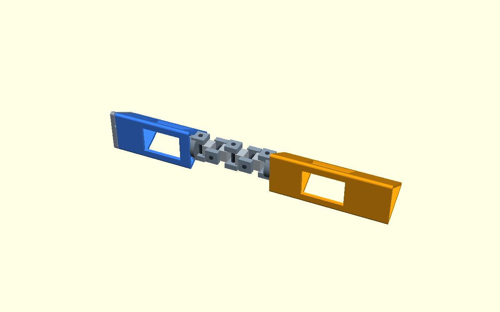

# 삼각기둥형 배관 검사 로봇 몸체 (Triangular Prism Body)

## 1. 설계 목적 및 구조

내경 **100 mm PVC 배관**에서 주행하는 검사 로봇의 몸체를 기존 원통형에서 **속이 빈 삼각기둥형**으로 변경한 1차 개념 설계이다. 앞뒤 몸체를 분리하고, 중앙에는 다관절 연결부를 배치하는 구성을 유지했다.

- 앞 몸체 길이: **75 mm**
- 뒤 몸체 길이: **105 mm**
- 삼각 단면의 외접원 반지름: **24 mm** (모서리 라운딩 반영)
- 외피 공칭 두께: **2.5 mm**
- 바퀴 모듈용 개구부: 몸체당 3개, 총 6개
- 개구부 공칭 크기: **축방향 38 mm × 면의 가로방향 24 mm** (임시값)
- 바퀴 모듈용 개구부를 삼각형의 **각 면 중앙에 배치**하여, 세 모서리의 길이 방향 연결부가 유지되도록 수정했다.

바퀴, 가이드봉(Ø4 mm), LM4UU 리니어 부싱, 압축 스프링, 모터 및 이들의 장착 구조는 **별도 모듈**로 제작할 예정이므로 이 모델에 포함하지 않았다. 중앙 다관절은 OpenSCAD 조립 미리보기용 개념 형상으로, 별도의 완성된 조인트 STL이 아니다.

## 2. 삼각기둥형 몸체의 장점

| 항목 | 장점 | 프로젝트 적용 의미 |
| --- | --- | --- |
| 바퀴 모듈 장착 | 평평한 3개 면을 활용할 수 있음 | 원통 곡면보다 가이드봉·부싱·스프링 고정부 설계 및 체결이 쉬울 수 있음 |
| 3방향 대칭 배치 | 세 면이 120° 간격으로 배치됨 | 배관 내벽을 향한 3개 바퀴 모듈 배치 기준을 잡기 쉬움 |
| 조립·정비 | 개구부로 내부에 접근 가능 | 모듈 교체, 배선 확인 및 조립 과정이 편리해질 수 있음 |
| 3D 프린팅 | 평면을 기준으로 배치·측정 가능 | 구멍 위치, 브래킷 및 체결부 설계가 단순해질 수 있음 |
| 모서리 연속성 | 이번 수정에서 세 모서리의 연결부를 유지 | 바퀴 개구부가 몸체를 완전히 분리하지 않도록 구조를 구성함 |

## 3. 삼각기둥형 몸체의 단점

| 항목 | 단점 및 위험 | 대응 방향 |
| --- | --- | --- |
| 내부 공간 | 동일한 외접원 크기의 원통보다 삼각형 단면 내부 공간이 작음 | 배터리·ESP32·모터드라이버 실측 후 배치 검토 |
| 엘보 통과 | 삼각형 모서리와 긴 몸체가 짧은 90° 엘보에서 간섭할 수 있음 | 모서리 라운딩, 몸체 길이 단축, 관절 가동 범위 검증 |
| 개구부 강성 | 각 면에 큰 구멍을 내면 외피 강성이 감소할 수 있음 | 모서리 연결부 두께·보강 리브·체결부 검토 |
| 부품 보호 | 바퀴용 개구부로 먼지·물·이물질이 유입될 수 있음 | 필요한 곳에 탈착식 커버나 차폐 구조 추가 |
| 모터·바퀴 간섭 | 면 폭과 내부 공간이 제한되어 압착 모듈의 이동거리가 부족할 수 있음 | 모듈 전체 이동 궤적과 실제 부품 치수 기반 검증 |
| 수직 주행 | 삼각기둥 단면 자체가 접지력이나 등반력을 보장하지 않음 | 스프링 압착력, 구동 토크, 바퀴 마찰 및 무게 시험 |

## 4. 기존 원통형과 비교

| 비교 항목 | 원통형 | 삼각기둥형 |
| --- | --- | --- |
| 바퀴 고정부 | 곡면에 맞춘 브래킷 또는 평탄화 필요 | **평면에 직접 설계하기 유리** |
| 내부 부품 공간 | 동일 외접원 조건에서 상대적으로 넓음 | **상대적으로 좁음** |
| 모서리 간섭 | 모서리 없음 | 모서리 라운딩 및 엘보 간섭 검토 필요 |
| 3륜 대칭 배치 | 둘레에 120° 간격 배치 가능 | 세 면에 120° 간격 배치 가능 |
| 제작·정비 | 외피와 개구부 구성에 따라 다름 | 평면 장착부 설계가 편리할 수 있음 |

**설계 판단:** 삼각기둥형은 바퀴 모듈을 별도 제작·고정하기 편리하다는 장점이 있지만, 좁은 내부 공간과 엘보 간섭 문제가 있어 원통형보다 주행 성능이 우수하다고 단정할 수 없다.

## 5. 파일 구성

| 파일 | 설명 |
| --- | --- |
| `triangular_shell_connected.scad` | 치수와 형상을 수정할 수 있는 OpenSCAD 원본 (`part` 설정으로 부품 선택) |
| `front.stl` | 앞쪽 삼각기둥 외피 STL |
| `rear.stl` | 뒤쪽 삼각기둥 외피 STL |
| `camera_plate.stl` | 전면 카메라 장착판 STL (중앙 Ø12 mm 구멍 등 임시 치수) |
| `preview.png` | 앞뒤 몸체와 중앙 다관절을 함께 표시한 개념 미리보기 |

## 6. 향후 검증 및 수정 항목

1. 실제 바퀴·모터·Ø4 가이드봉·LM4UU 부싱·스프링을 조합한 **모듈의 최대 외형과 이동 거리** 측정
2. 각 면의 38 × 24 mm 개구부와 모듈 간 간섭 및 **나사 체결부** 설계
3. 배터리·ESP32·모터드라이버 등 **실제 내부 배치 가능 여부** 확인
4. **내경 100 mm 배관의 짧은 90° 엘보**에서 앞뒤 몸체와 모서리 간섭 확인
5. 수직 주행에 필요한 압착력, 마찰력 및 모터 토크 검증
6. 3D 프린팅 방향, 공차, 모서리 연결부 강도 및 조립성 검토

> **주의:** 이 모델은 구조 비교용 **1차 개념 모델**이다. 바퀴 모듈 체결 구멍 및 중앙 다관절의 실제 회전·결합 치수는 검증되지 않았다. STL이 존재한다는 사실이 실제 조립·주행 가능성을 의미하지 않는다.
